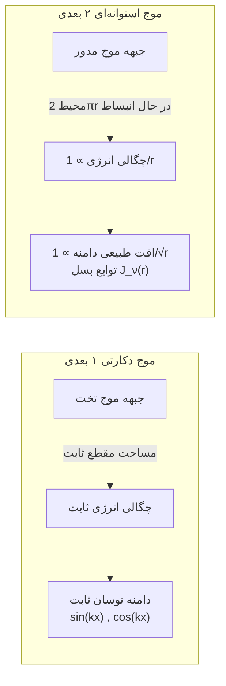
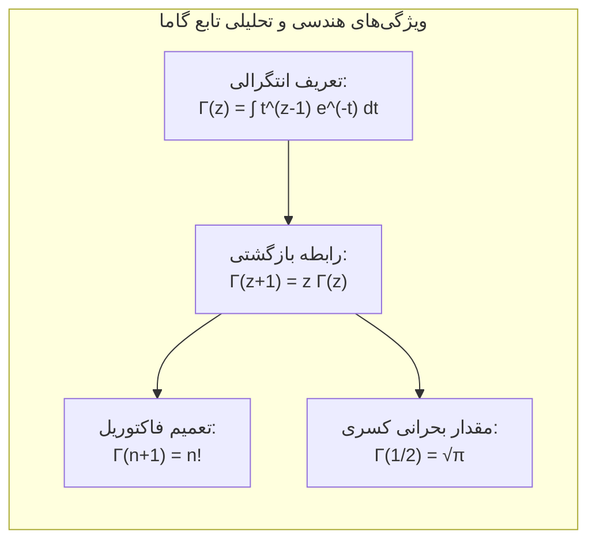
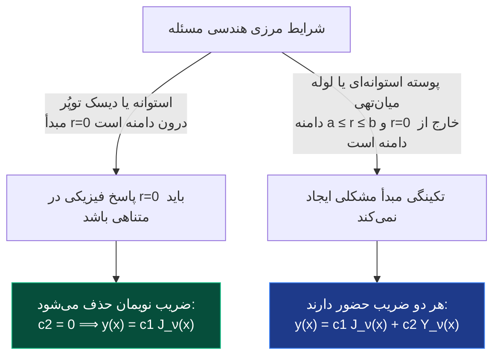

# معادلات دیفرانسیل بسل و توابع بسل

**معادله دیفرانسیل بسل (Bessel's Differential Equation)** یکی از ارکان بنیادین فیزیک ریاضی و مهندسی است. این معادله زمانی ظاهر می‌شود که بخواهیم پدیده‌های موجی، انتقال حرارت، پتانسیل الکترواستاتیک یا ارتعاشات مکانیکی را در **سیستم‌های با تقارن استوانه‌ای یا کروی** (نظیر غشای مدور طبل، فیبرهای نوری، کابل‌های هم‌محور، لوله‌های انتقال سیال و رآکتورهای استوانه‌ای) مدل‌سازی کنیم. 

در این راهنمای جامع، ابتدا شهود فیزیکی پیدایش معادله بسل را از روی معادله موج بررسی می‌کنیم، با تعمیم فاکتوریل توسط **تابع گاما** و مشتقات کسری آشنا می‌شویم، سپس گام‌به‌گام معادله را به روش **فروبنیوس** حل کرده و رفتار توابع نوع اول و دوم را در یک **آزمایشگاه تعاملی دوبعدی و سه‌بعدی** به تماشا می‌نشینیم.

---

## شهود فیزیکی و پیدایش معادله بسل

برای درک عمیق معادله بسل، بیایید رفتار موج را در دو هندسه متفاوت با هم مقایسه کنیم: **هندسه دکارتی یک‌بعدی** در برابر **هندسه قطبی/استوانه‌ای دو‌بعدی**.

### مقایسه موج یک‌بعدی و موج در هندسه مدور

در یک تار مرتعش یا لوله صوتی باریک یک‌بعدی (دستگاه دکارتی)، معادله دیفرانسیل حاکم بر مد نوسان به فرم زیر است:

$$\frac{d^2 y}{dx^2} + k^2 y = 0$$

پاسخ عمومی این معادله، ترکیبی از توابع سینوسی و کسینوسی با **دامنه ثابت** است:

$$y(x) = A \cos(kx) + B \sin(kx)$$

در این حالت، سطح مقطع جبهه موج در حین حرکت در راستای $x$ هیچ تغییری نمی‌کند؛ بنابراین چگالی انرژی موج ثابت مانده و نوسانات بدون هیچ‌گونه افت دامنه‌ای تا بی‌نهایت ادامه می‌یابند.

اما هنگامی که سنگی را در آب می‌اندازید یا پرده مدور یک طبل را به ارتعاش درمی‌آورید، جبهه موج به شکل دوایر هم‌مرکز به سمت بیرون پخش می‌شود. در مختصات قطبی $(r, \theta)$، عملگر لاپلاسی دو‌بعدی برابر است با:

$$\nabla^2 u = \frac{\partial^2 u}{\partial r^2} + \frac{1}{r} \frac{\partial u}{\partial r} + \frac{1}{r^2} \frac{\partial^2 u}{\partial \theta^2}$$

### راز جمله میراکننده هندسی $\frac{1}{r} \frac{dR}{dr}$

حضور جمله مرتبه اول $\frac{1}{r} \frac{dR}{dr}$ در لاپلاسی قطبی، نمایانگر یک **میرایی هندسی (Geometric Damping)** ذاتی ناشی از انبساط محیط است:

> [!NOTE] دلیل فیزیکی افت دامنه در هندسه استوانه‌ای
> بر طبق اصل بقای انرژی، توان یا انرژی کل یک جبهه موج نوسانی با گسترش به سمت بیرون پایسته است. وقتی موج از مرکز به شعاع $r$ می‌رسد، انرژی روی محیط دایره‌ای به طول $2\pi r$ توزیع می‌شود؛ در نتیجه چگالی انرژی در واحد طول متناسب با $\frac{1}{r}$ کاهش می‌یابد:
>
> $$\text{Energy Density} \propto \frac{1}{r}$$
>
> از آنجا که انرژی نوسان مکانیکی متناسب با توان دوم دامنه نوسان ($E \propto A^2$) است، بلافاصله نتیجه می‌شود که دامنه نوسان شعاعی باید متناسب با معکوس جذر شعاع افت کند:
>
> $$A(r) \propto \frac{1}{\sqrt{r}}$$
>
> جمله $\frac{1}{r} \frac{dR}{dr}$ دقیقاً همانند یک نیروی اصطکاک مجازی رفتار می‌کند که انرژی را از چگالی خطی موج جذب کرده و دامنه نوسان را ملایم‌تر می‌سازد. به همین دلیل توابع بسل درست مانند امواج سینوسی نوسان می‌کنند، اما با افزایش شعاع دامنه آن‌ها پیوسته کوچک و کوچک‌تر می‌شود.

### تفکیک متغیرها و استخراج فرم استاندارد بسل

معادله موج دو‌بعدی برای غشای ارتعاشی را در نظر بگیرید:

$$\nabla^2 u = \frac{1}{c^2} \frac{\partial^2 u}{\partial t^2}$$

با فرض پاسخ هارمونیک در زمان $u(r, \theta, t) = v(r, \theta) e^{i\omega t}$ و تعریف عدد موج $k = \frac{\omega}{c}$، به معادله هلم‌هولتز می‌رسیم:

$$\nabla^2 v + k^2 v = 0 \implies \frac{\partial^2 v}{\partial r^2} + \frac{1}{r} \frac{\partial v}{\partial r} + \frac{1}{r^2} \frac{\partial^2 v}{\partial \theta^2} + k^2 v = 0$$

پاسخ مکانی را به صورت ضرب دو تابع شعاعی و زاویه‌ای تفکیک می‌کنیم: $v(r, \theta) = R(r) \, \Theta(\theta)$. با جایگذاری و تقسیم بر $\frac{R \Theta}{r^2}$:

$$\frac{r^2 R'' + r R' + k^2 r^2 R}{R} = -\frac{\Theta''}{\Theta} = \nu^2$$

چون طرف چپ تنها تابعی از $r$ و طرف راست تنها تابعی از $\theta$ است، هر دو باید با ثابت جداسازی $\nu^2$ برابر باشند:

1. **معادله زاویه‌ای:** $\Theta'' + \nu^2 \Theta = 0 \implies \Theta(\theta) = A \cos(\nu\theta) + B \sin(\nu\theta)$. برای اینکه با یک دور کامل دوران پاسخ پیوسته بماند ($\Theta(\theta + 2\pi) = \Theta(\theta)$)، باید $\nu = m \in \{0, 1, 2, \dots\}$ عددی صحیح باشد.
2. **معادله شعاعی:**

$$r^2 \frac{d^2 R}{dr^2} + r \frac{dR}{dr} + (k^2 r^2 - \nu^2) R = 0$$

اکنون با تغییر متغیر بدون‌بعد $x = kr$ (که در آن $dx = k \, dr$، $\frac{dR}{dr} = k \frac{dR}{dx}$ و $\frac{d^2 R}{dr^2} = k^2 \frac{d^2 R}{dx^2}$)، به فرم جهان‌شمول و نام‌آشنای **معادله دیفرانسیل بسل مرتبه $\nu$** می‌رسیم:

> [!IMPORTANT] فرم استاندارد معادله بسل
>
> $$x^2 y'' + x y' + (x^2 - \nu^2)y = 0$$
>
> یا به فرم نرمال:
>
> $$y'' + \frac{1}{x} y' + \left(1 - \frac{\nu^2}{x^2}\right)y = 0$$

---

## تابع گاما؛ تعمیم فاکتوریل و مشتقات کسری

پیش از آنکه به حل معادله بسل بپردازیم، به ابزاری نیاز داریم که بتواند فاکتوریل را از اعداد طبیعی به اعداد حقیقی و مختلط تعمیم دهد. این ابزار، **تابع گامای اویلر ($\Gamma$)** نام دارد.

### تعریف انتگرالی اویلر و خاصیت بازگشتی

تابع گاما برای هر عدد با بخش حقیقی مثبت ($\operatorname{Re}(z) > 0$) با انتگرال ناسره زیر تعریف می‌شود:

$$\Gamma(z) = \int_0^\infty t^{z-1} e^{-t} \, dt$$

با به‌کارگیری روش انتگرال‌گیری جزء‌به‌جزء بر روی این انتگرال:

$$\Gamma(z+1) = \int_0^\infty t^z e^{-t} \, dt = \left[ -t^z e^{-t} \right]_0^\infty + z \int_0^\infty t^{z-1} e^{-t} \, dt = 0 + z \Gamma(z)$$

بنابراین رابطه بازگشتی کلیدی تابع گاما اثبات می‌شود:

$$\Gamma(z+1) = z \Gamma(z)$$

با توجه به اینکه $\Gamma(1) = \int_0^\infty e^{-t} dt = 1$ است، به سادگی می‌توان دید که برای هر عدد صحیح مثبت $n$:

$$\Gamma(n+1) = n \cdot (n-1) \cdots 1 \cdot \Gamma(1) = n! \iff \Gamma(n) = (n-1)!$$

### مقدار مشهور $\Gamma(1/2) = \sqrt{\pi}$

برای مقادیر نیمه‌صحیح، با تغییر متغیر $t = u^2$ (و $dt = 2u \, du$):

$$\Gamma\left(\frac{1}{2}\right) = \int_0^\infty t^{-1/2} e^{-t} \, dt = \int_0^\infty \frac{1}{u} e^{-u^2} (2u \, du) = 2 \int_0^\infty e^{-u^2} \, du = \int_{-\infty}^\infty e^{-u^2} \, du = \sqrt{\pi}$$

این نتیجه حیرت‌انگیز پیوند میان فاکتوریل و عدد $\pi$ را برقرار می‌سازد: $\left(-\frac{1}{2}\right)! = \sqrt{\pi}$ و $\left(\frac{1}{2}\right)! = \frac{\sqrt{\pi}}{2}$.

### ارتباط با حساب کسری (Fractional Calculus)

در ریاضیات مقدماتی، مشتق مرتبه $k$-ام تک‌جمله‌ای $x^n$ با فرمول زیر محاسبه می‌شود:

$$\frac{d^k}{dx^k} x^n = \frac{n!}{(n-k)!} x^{n-k}$$

اگر بخواهیم عملگر مشتق را به مرتبه‌های غیرصحیح $\alpha \in \mathbb{R}$ (مانند مشتق نیم‌مرتبه $\frac{d^{1/2}}{dx^{1/2}}$) تعمیم دهیم، فاکتوریل‌ها با تابع گاما جایگزین می‌شوند:

> [!TIP] فرمول مشتق کسری ریمان-لیوویل
>
> $$\frac{d^\alpha}{dx^\alpha} x^n = \frac{\Gamma(n+1)}{\Gamma(n+1-\alpha)} x^{n-\alpha}$$
>
> برای مثال، مشتق نیم‌مرتبه تابع $x$:
>
> $$\frac{d^{1/2}}{dx^{1/2}} x = \frac{\Gamma(2)}{\Gamma(1.5)} x^{0.5} = \frac{1}{\frac{\sqrt{\pi}}{2}} \sqrt{x} = \frac{2\sqrt{x}}{\sqrt{\pi}}$$

این تعمیم دقیقاً همان دلیلی است که به ما اجازه می‌دهد فرمول حل سری بسل را نه فقط برای مرتبه‌های صحیح، بلکه به صورت یکپارچه برای **تمام مرتبه‌های حقیقی $\nu \ge 0$** بیان کنیم.

---

## حل گام‌به‌گام به روش فروبنیوس

معادله دیفرانسیل بسل را بار دیگر بازنویسی می‌کنیم:

$$x^2 y'' + x y' + (x^2 - \nu^2)y = 0$$

تقسیم بر $x^2$ برای بررسی ماهیت نقطه $x = 0$:

$$y'' + \frac{1}{x} y' + \frac{x^2 - \nu^2}{x^2} y = 0$$

توابع ضرایب عبارتند از $P(x) = \frac{1}{x}$ و $Q(x) = \frac{x^2 - \nu^2}{x^2}$. مشاهده می‌شود که این توابع در $x = 0$ تحلیلی نیستند؛ اما حدها متناهی هستند:

$$\lim_{x \to 0} x P(x) = 1 = p_0, \qquad \lim_{x \to 0} x^2 Q(x) = -\nu^2 = q_0$$

بنابراین $x = 0$ یک **نقطه تکین منظم (Regular Singular Point)** است و طبق قضیه فروبنیوس، حداقل یک جواب به صورت سری توانی تعمیم‌یافته وجود دارد.

### گام اول: بسط فروبنیوس و مشتقات

پاسخ را به صورت سری تعمیم‌یافته با ضریب ابتدایی غیرصفر ($a_0 \neq 0$) فرض می‌کنیم:

$$y(x) = \sum_{m=0}^\infty a_m x^{m+r}$$

مشتقات اول و دوم عبارتند از:

$$y'(x) = \sum_{m=0}^\infty (m+r) a_m x^{m+r-1}$$

$$y''(x) = \sum_{m=0}^\infty (m+r)(m+r-1) a_m x^{m+r-2}$$

### گام دوم: جایگذاری در معادله بسل

با جایگذاری در معادله اصلی $x^2 y'' + x y' + (x^2 - \nu^2)y = 0$:

$$\sum_{m=0}^\infty (m+r)(m+r-1) a_m x^{m+r} + \sum_{m=0}^\infty (m+r) a_m x^{m+r} + \sum_{m=0}^\infty a_m x^{m+r+2} - \nu^2 \sum_{m=0}^\infty a_m x^{m+r} = 0$$

جملات با توان مشترک $x^{m+r}$ را ادغام می‌کنیم:

$$\sum_{m=0}^\infty \left[ (m+r)(m+r-1) + (m+r) - \nu^2 \right] a_m x^{m+r} + \sum_{m=0}^\infty a_m x^{m+r+2} = 0$$

عبارت داخل کروشه به زیبایی ساده می‌شود:

$$(m+r)(m+r-1) + (m+r) = (m+r)^2$$

بنابراین:

$$\sum_{m=0}^\infty \left[ (m+r)^2 - \nu^2 \right] a_m x^{m+r} + \sum_{m=0}^\infty a_m x^{m+r+2} = 0$$

### گام سوم: استخراج معادله شاخص (Indicial Equation)

پایین‌ترین توان موجود در معادله، توان $x^r$ است که از جمله اول به ازای $m = 0$ به دست می‌آید:

$$\left( r^2 - \nu^2 \right) a_0 = 0$$

چون طبق فرض فروبنیوس $a_0 \neq 0$ است، باید ضریب آن برابر صفر باشد:

> [!IMPORTANT] معادله شاخص بسل
>
> $$r^2 - \nu^2 = 0 \implies r_1 = \nu, \quad r_2 = -\nu$$

با فرض $\nu \ge 0$، بزرگ‌ترین ریشه $r_1 = \nu$ را انتخاب می‌کنیم.

### گام چهارم: توان $x^{r+1}$ و حذف ضرایب فرد

توان بعدی $x^{r+1}$ به ازای $m = 1$ در سری اول است (زیرا در سری دوم توان‌ها از $r+2$ آغاز می‌شوند):

$$\left[ (r+1)^2 - \nu^2 \right] a_1 = 0$$

با قرار دادن $r = \nu$:

$$\left[ (\nu+1)^2 - \nu^2 \right] a_1 = (2\nu + 1) a_1 = 0$$

چون $\nu \ge 0$ است، همواره $2\nu + 1 > 0$ بوده و در نتیجه الزماً:

$$a_1 = 0$$

### گام پنجم: رابطه بازگشتی برای توان‌های عمومی

برای توان‌های عمومی $x^{m+r}$ به ازای $m \ge 2$، اندیس سری دوم را شیفت می‌دهیم ($\sum_{m=0}^\infty a_m x^{m+r+2} = \sum_{m=2}^\infty a_{m-2} x^{m+r}$):

$$\left[ (m+r)^2 - \nu^2 \right] a_m + a_{m-2} = 0 \qquad (m \ge 2)$$

با جایگذاری $r = \nu$:

$$\left[ (m+\nu)^2 - \nu^2 \right] a_m = \left( m^2 + 2m\nu \right) a_m = m(m + 2\nu) a_m = -a_{m-2}$$

بنابراین رابطه بازگشتی طلایی فروبنیوس به دست می‌آید:

$$a_m = -\frac{a_{m-2}}{m(m + 2\nu)} \qquad (m \ge 2)$$

### گام ششم: صفر شدن ضرایب فرد و فرمول ضرایب زوج

چون $a_1 = 0$ است، طبق رابطه بازگشتی:

$$a_3 = -\frac{a_1}{3(3+2\nu)} = 0, \quad a_5 = 0, \quad \dots \implies a_{2k+1} = 0 \quad (\forall k \ge 0)$$

تمام ضرایب با اندیس فرد یکسره ناپدید می‌شوند! حال برای ضرایب زوج، متغیر $m = 2k$ را قرار می‌دهیم:

$$a_{2k} = -\frac{a_{2k-2}}{2k(2k + 2\nu)} = -\frac{a_{2k-2}}{4k(k + \nu)} = -\frac{a_{2k-2}}{2^2 k(k + \nu)}$$

چند جمله اول را پی‌درپی می‌نویسیم:

$$a_2 = -\frac{a_0}{2^2 \cdot 1 \cdot (1+\nu)}$$

$$a_4 = -\frac{a_2}{2^2 \cdot 2 \cdot (2+\nu)} = \frac{a_0}{2^4 \cdot (1 \cdot 2) \cdot (1+\nu)(2+\nu)}$$

$$a_6 = -\frac{a_4}{2^2 \cdot 3 \cdot (3+\nu)} = -\frac{a_0}{2^6 \cdot (1 \cdot 2 \cdot 3) \cdot (1+\nu)(2+\nu)(3+\nu)}$$

الگوی کلی برای ضریب $2k$-ام به وضوح مشخص می‌شود:

$$a_{2k} = \frac{(-1)^k a_0}{2^{2k} k! \, (1+\nu)(2+\nu)\cdots(k+\nu)}$$

### گام هفتم: استانداردسازی و پیدایش فرم بسته $J_\nu(x)$

ضریب $a_0$ یک ثابت اختیاری است. برای اینکه رابطه بالا به یک فرم بسته، متقارن و زیبا تبدیل شود، اویلر و بسل ضریب $a_0$ را به شکل زیر تعریف کردند:

$$a_0 = \frac{1}{2^\nu \Gamma(\nu+1)}$$

طبق خاصیت بازگشتی تابع گاما:

$$(k+\nu)(k-1+\nu)\cdots(1+\nu) \Gamma(\nu+1) = \Gamma(\nu+k+1)$$

با جایگذاری $a_0$ در فرمول $a_{2k}$:

$$a_{2k} = \frac{(-1)^k}{2^{2k+\nu} k! \, \Gamma(\nu+k+1)}$$

با بازگشت به سری $y(x) = \sum_{k=0}^\infty a_{2k} x^{2k+\nu}$، فرمول جاودانه **تابع بسل نوع اول مرتبه $\nu$** آشکار می‌شود:

> [!IMPORTANT] فرم بسته تابع بسل نوع اول $J_\nu(x)$
>
> $$J_\nu(x) = \sum_{k=0}^\infty \frac{(-1)^k}{k! \, \Gamma(\nu+k+1)} \left(\frac{x}{2}\right)^{2k+\nu}$$
>
> برای مرتبه‌های صحیح $\nu = n \in \{0, 1, 2, \dots\}$، با توجه به اینکه $\Gamma(n+k+1) = (n+k)!$ است:
>
> $$J_n(x) = \sum_{k=0}^\infty \frac{(-1)^k}{k! \, (n+k)!} \left(\frac{x}{2}\right)^{2k+n}$$

چند بسط ابتدایی برای مراتب پرکاربرد:

$$J_0(x) = 1 - \frac{x^2}{2^2} + \frac{x^4}{2^2 \cdot 4^2} - \frac{x^6}{2^2 \cdot 4^2 \cdot 6^2} + \dots = 1 - \frac{x^2}{4} + \frac{x^4}{64} - \frac{x^6}{2304} + \dots$$

$$J_1(x) = \frac{x}{2} - \frac{x^3}{2^2 \cdot 4} + \frac{x^5}{2^2 \cdot 4^2 \cdot 6} - \dots = \frac{x}{2} - \frac{x^3}{16} + \frac{x^5}{384} - \dots$$

همچنین رابطه مشتق شگفت‌انگیزی میان آن‌ها برقرار است:

$$J_0'(x) = -J_1(x), \qquad \frac{d}{dx}\left[ x^\nu J_\nu(x) \right] = x^\nu J_{\nu-1}(x)$$

---

## استقلال خطی، تابع بسل نوع دوم (نویمان) و شرایط مرزی فیزیکی

معادله بسل مرتبه دوم است؛ بنابراین فضای پاسخ آن **دو‌بعدی** بوده و همواره نیازمند **دو جواب مستقل خطی** هستیم.

### حالت اول: مرتبه غیرصحیح ($\nu \notin \mathbb{Z}$)

اگر ریشه دوم معادله شاخص $r_2 = -\nu$ را به کار بگیریم، تابع $J_{-\nu}(x)$ به دست می‌آید:

$$J_{-\nu}(x) = \sum_{k=0}^\infty \frac{(-1)^k}{k! \, \Gamma(k - \nu + 1)} \left(\frac{x}{2}\right)^{2k-\nu}$$

چون تفاضل ریشه‌های شاخص $r_1 - r_2 = 2\nu$ عدد صحیح نیست، دترمینان ورونسکیان آن‌ها مخالف صفر است:

$$W[J_\nu(x), J_{-\nu}(x)] = -\frac{2\sin(\nu\pi)}{\pi x} \neq 0$$

بنابراین $J_\nu(x)$ و $J_{-\nu}(x)$ کاملاً مستقل خطی هستند و پاسخ عمومی برابر است با:

$$y(x) = c_1 J_\nu(x) + c_2 J_{-\nu}(x) \qquad (\nu \notin \mathbb{Z})$$

### حالت دوم: مرتبه صحیح ($\nu = n \in \mathbb{Z}$) و وابستگی خطی

هنگامی که $\nu$ عدد صحیح باشد، تفاضل دو ریشه $2n$ عددی صحیح است. با توجه به اینکه تابع گاما در اعداد صحیح منفی یا صفر میل به بی‌نهایت می‌کند ($\frac{1}{\Gamma(k-n+1)} = 0$ برای $k < n$):

$$J_{-n}(x) = (-1)^n J_n(x)$$

> [!WARNING] بحران وابستگی خطی
> برای مرتبه‌های صحیح، $J_{-n}(x)$ چیزی جز یک مضرب اسکالر از $J_n(x)$ نیست! بنابراین نمی‌تواند جواب دوم مستقل باشد. برای کامل کردن پایه فضا، باید جواب دوم مستقلی با روش‌های دیگر جستجو شود.

### تابع بسل نوع دوم یا نویمان $Y_\nu(x)$

برای رفع این مشکل در تمامی شرایط، کارل نویمان (Carl Neumann) و هاینریش وبر تابع بسل نوع دوم $Y_\nu(x)$ (که با $N_\nu(x)$ نیز نمایش داده می‌شود) را تعریف کردند:

$$Y_\nu(x) = \frac{J_\nu(x) \cos(\nu\pi) - J_{-\nu}(x)}{\sin(\nu\pi)}$$

برای مرتبه‌های صحیح $n$، صورت و مخرج هر دو صفر می‌شوند و مقدار تابع با **قاعده هوپیتال** به صورت حد تعریف می‌شود:

$$Y_n(x) = \lim_{\nu \to n} Y_\nu(x)$$

بدین ترتیب، ورونسکیان همواره مخالف صفر باقی می‌ماند:

$$W[J_\nu(x), Y_\nu(x)] = \frac{2}{\pi x} \neq 0$$

و **پاسخ عمومی جامع معادله بسل برای هر $\nu$** به شکل استاندارد زیر درمی‌آید:

> [!IMPORTANT] پاسخ عمومی استاندارد معادله بسل
>
> $$y(x) = c_1 J_\nu(x) + c_2 Y_\nu(x)$$

### تکینگی لگاریتمی $Y_\nu(x)$ در مبدأ و فلسفه فیزیکی حذف آن

یکی از بارزترین تفاوت‌های میان $J_\nu(x)$ و $Y_\nu(x)$، رفتار آن‌ها در نزدیکی مبدأ ($x \to 0^+$) است:

1. **تابع نوع اول $J_\nu(x)$:** در مبدأ کاملاً خوش‌رفتار و متناهی است:
   $$J_0(0) = 1, \qquad J_\nu(0) = 0 \quad (\nu > 0)$$
2. **تابع نوع دوم $Y_\nu(x)$:** در مبدأ دارای یک **تکینگی لگاریتمی شدید** است و به سمت منفی بی‌نهایت میل می‌کند:
   $$Y_0(x) \approx \frac{2}{\pi} \left[ \ln\left(\frac{x}{2}\right) + \gamma \right] \xrightarrow{x \to 0^+} -\infty$$
   $$Y_\nu(x) \approx -\frac{\Gamma(\nu)}{\pi} \left(\frac{2}{x}\right)^\nu \xrightarrow{x \to 0^+} -\infty \quad (\nu > 0)$$

| تابع بسل | رفتار در مبدأ ($x = 0$) | تکینگی | رفتار مجانبی در فواصل دور ($x \to \infty$) | کاربرد در فیزیک |
| :---: | :---: | :---: | :---: | :---: |
| **$J_\nu(x)$** (نوع اول) | متناهی ($J_0(0)=1$, $J_{\nu>0}(0)=0$) | فاقد تکینگی | $\sqrt{\frac{2}{\pi x}} \cos\left(x - \frac{\nu\pi}{2} - \frac{\pi}{4}\right)$ | استوانه‌ها و دیسک‌های توپُر شامل مرکز |
| **$Y_\nu(x)$** (نوع دوم / نویمان) | منفجر شونده به $-\infty$ | تکینگی لگاریتمی | $\sqrt{\frac{2}{\pi x}} \sin\left(x - \frac{\nu\pi}{2} - \frac{\pi}{4}\right)$ | پوسته‌های استوانه‌ای و لوله‌های میان‌تهی |

> [!NOTE] استدلال فیزیکی انتخاب ضرایب
> در مسائل مهندسی که ناحیه مورد مطالعه شامل مرکز دایره یا استوانه است (مانند پوست طبل، توزیع حرارت داخل میله استوانه‌ای توپر، یا میدان در مرکز فیبر نوری)، جابه‌جایی، دما یا پتانسیل در مرکز فیزیکی $r=0$ نمی‌تواند بی‌نهایت شود! از آنجا که $Y_\nu(0) = -\infty$ است، قوانین طبیعت الزام می‌کنند که **$c_2 = 0$** باشد و تنها $J_\nu(x)$ باقی بماند.
> 
> اما در یک کابل کواکسیال یا یک لوله دوجداره که ناحیه مجاز بین دو شعاع $r_1 < r < r_2$ محصور است، نقطه $r=0$ درون دامنه فیزیکی قرار ندارد؛ بنابراین هر دو ضریب $c_1$ و $c_2$ زنده می‌مانند تا شرایط مرزی روی هر دو جداره را تأمین کنند.

---

## آزمایشگاه تعاملی: پلاتر دو بعدی و شبیه‌ساز سه‌بعدی ارتعاش پرده طبل

در این بخش، دو ابزار تحلیلی و شبیه‌سازی تعاملی پیاده‌سازی شده است تا مفهوم انتزاعی توابع بسل را به تجربه بصری زنده تبدیل کند:

1. **پلاتر تعاملی دوبعدی:** بررسی شکل موج، تغییرات پیوسته مرتبه $\nu$ از ۰ تا ۵، مشاهده اثر ترکیب خطی $c_1 J_\nu + c_2 Y_\nu$ و شناسایی ریشه‌ها (نقاط صفر).
2. **شبیه‌ساز سه‌بعدی ارتعاش پرده طبل:** نمایش مدهای ارتعاشی دوبعدی $z(r, \theta, t) = J_m\left(\alpha_{mn} \frac{r}{R}\right) \cos(m\theta) \cos(\omega t)$ با قابلیت دوران کامل سه‌بعدی ماوس و تاچ.

  
  <!-- Tab Buttons -->
  

    <button class="bessel-tab-btn active" id="btnTab2D" onclick="switchBesselTab('2d')">
      <svg width="18" height="18" viewBox="0 0 24 24" fill="none" stroke="currentColor" stroke-width="2"><path d="M3 3v18h18"/><path d="M18.7 8l-5.1 5.2-2.8-2.7L7 14.3"/></svg>
      پلاتر دوبعدی توابع بسل ($J_\nu$ و $Y_\nu$)
    </button>
    <button class="bessel-tab-btn" id="btnTab3D" onclick="switchBesselTab('3d')">
      <svg width="18" height="18" viewBox="0 0 24 24" fill="none" stroke="currentColor" stroke-width="2"><circle cx="12" cy="12" r="10"/><path d="M12 2a14.5 14.5 0 0 0 0 20 14.5 14.5 0 0 0 0-20"/><path d="M2 12h20"/></svg>
      شبیه‌ساز سه‌بعدی ارتعاش پرده طبل (Drumhead)
    </button>
  

  <!-- TAB 1: 2D PLOTTER -->
  

    

      

        
        

          

            مرتبه تابع بسل ($\nu$):
            0.0
          

          <input type="range" id="sliderNu" min="0" max="5" step="0.5" value="0" class="bessel-slider">
          

            012345
          

        

        

          

            ضریب $J_\nu$ ($c_1$):
            1.0
          

          <input type="range" id="sliderC1" min="-2" max="2" step="0.1" value="1.0" class="bessel-slider">
        

        

          

            ضریب $Y_\nu$ ($c_2$):
            0.0
          

          <input type="range" id="sliderC2" min="-2" max="2" step="0.1" value="0.0" class="bessel-slider">
        

      

      

        <button type="button" class="bessel-toggle-pill active" id="btnToggleJ" onclick="toggleCurve('J')">
          
          نمایش تابع نوع اول $J_\nu(x)$
        </button>

        <button type="button" class="bessel-toggle-pill active" id="btnToggleY" onclick="toggleCurve('Y')">
          
          نمایش تابع نویمان $Y_\nu(x)$
        </button>

        <button type="button" class="bessel-toggle-pill active" id="btnToggleComb" onclick="toggleCurve('Comb')">
          
          ترکیب خطی $y = c_1 J_\nu + c_2 Y_\nu$
        </button>

        <button type="button" class="bessel-toggle-pill active" id="btnToggleRoots" onclick="toggleCurve('Roots')">
          
          علامت‌گذاری ریشه‌ها
        </button>
      

    

    

      <canvas id="bessel2DCanvas" width="900" height="480"></canvas>
      

    

    

      

         <strong>$J_\nu(x)$:</strong> در $x=0$ متناهی است ($J_0(0)=1$).
      

      

         <strong>$Y_\nu(x)$:</strong> در $x \to 0$ تکینگی لگاریتمی ($-\infty$) دارد.
      

      

         <strong>نقاط ریشه:</strong> موقعیت گره‌های ارتعاشی یا فرکانس‌های تشدید.
      

    

  

  <!-- TAB 2: 3D DRUMHEAD SIMULATOR -->
  

    

      

        

          <label class="bessel-field-label">تقارن دورانی / خطوط گره قطری ($m$):</label>
          

            <button class="bessel-btn-opt active" onclick="setModeM(0)">m = 0 (متقارن محوری)</button>
            <button class="bessel-btn-opt" onclick="setModeM(1)">m = 1 (۱ قطر گره)</button>
            <button class="bessel-btn-opt" onclick="setModeM(2)">m = 2 (۲ قطر گره)</button>
            <button class="bessel-btn-opt" onclick="setModeM(3)">m = 3 (۳ قطر گره)</button>
          

        

        

          <label class="bessel-field-label">ریشه شعاعی / دوایر گره ($n$):</label>
          

            <button class="bessel-btn-opt active" onclick="setModeN(1)">n = 1 (فقط لبه ثابت)</button>
            <button class="bessel-btn-opt" onclick="setModeN(2)">n = 2 (۱ دایره ساکن داخلی)</button>
            <button class="bessel-btn-opt" onclick="setModeN(3)">n = 3 (۲ دایره ساکن داخلی)</button>
          

        

      

      

        <button class="bessel-action-btn" id="btnPlayPause" onclick="togglePlayPause()">
          ⏸️
          توقف انیمیشن
        </button>

        <button class="bessel-action-btn" onclick="reset3DView()">
          🔄
          بازنشانی زاویه دید
        </button>

        

          سرعت نوسان:
          <input type="range" id="sliderSpeed" min="0.2" max="2.5" step="0.1" value="1.0" class="bessel-slider">
        

        <button type="button" class="bessel-action-btn active" id="btnWireframe" onclick="toggleWireframe()">
          🌐
          وایرفریم فعال
        </button>
      

      

        

          مد ارتعاشی:
          <strong id="modeName">$(0, 1)$</strong>
        

        

          مقدار ریشه $\alpha_{mn}$:
          <strong id="rootVal">2.4048</strong>
        

        

          نسبت فرکانس به مد پایه:
          <strong id="freqRatio">1.000 $\times f_{01}$</strong>
        

        

          گره‌های ساکن:
          فاقد قطر گره، لبه در $r=R$ قفل شده
        

      

    

    

      <canvas id="drum3DCanvas" width="900" height="520"></canvas>
      
برای چرخش زاویه دید، با ماوس درگ کنید یا لمس نمایید

    

  

---

## کاربردهای مهندسی و صنعتی معادلات بسل

توابع بسل در سراسر شاخه‌های مهندسی حضور دارند و زبان ریاضی تحلیل پدیده‌های استوانه‌ای به شمار می‌روند:

### مهندسی مکانیک، مکاترونیک و آکوستیک

1. **طراحی تغذیه‌کننده‌های ارتعاشی (Vibratory Bowl Feeders):** در خطوط تولید و بسته‌بندی صنایع دارویی و خودروسازی، کاسه‌های ارتعاشی قطعات را از طریق ارتعاشات تشدیدی مرتب و هدایت می‌کنند. مدهای تشدید این کاسه‌ها مستقیماً ریشه‌های توابع بسل هستند.
2. **دیافراگم میکروفون‌ها و حسگرهای پیزوالکتریک:** در ترانسدیوسرهای اولتراسونیک پزشکی و صنعتی، شناخت محل خطوط گره (Nodal Lines) به مهندسان اجازه می‌دهد سنسورها را در نقاط بیشترین دامنه نوسان مستقر سازند تا حساسیت بیشینه شود.

### مهندسی مخابرات، فوتونیک و فیبر نوری

1. **انتشار امواج در فیبرهای نوری (Step-Index Fibers):** توزیع میدان الکتریکی در هسته شیشه‌ای استوانه‌ای فیبر نوری توسط تابع بسل نوع اول $J_m(kr)$ و در پوسته (Cladding) توسط تابع بسل اصلاح‌شده نوع دوم $K_m(\gamma r)$ توصیف می‌شود. ریشه‌های بسل مشخص‌کننده مدهای انتشاری (LP Modes) هستند.
2. **موج‌برهای استوانه‌ای و کابل‌های کواکسیال:** مدهای الکترومغناطیسی عرضی ($TE_{mn}$ و $TM_{mn}$) در موج‌برهای راداری مستقیماً از ریشه‌های $J_n(x)$ و مشتق آن $J_n'(x)$ به دست می‌آیند.

### پردازش سیگنال و مدولاسیون فرکانس (FM)

در مخابرات بی‌سیم، سیگنال مدوله‌شده فرکانسی دارای شکل موج زیر است:

$$s(t) = A_c \cos\left( \omega_c t + \beta \sin(\omega_m t) \right)$$

با استفاده از **بسط ژاکوبی-انگر (Jacobi-Anger Expansion)**:

$$e^{i \beta \sin\theta} = \sum_{n=-\infty}^\infty J_n(\beta) e^{i n \theta}$$

طیف فرکانسی سیگنال FM به صورت مجموعه‌ای از هارمونیک‌های مجزا با ضرایب دامنه $J_n(\beta)$ به دست می‌آید:

$$s(t) = A_c \sum_{n=-\infty}^\infty J_n(\beta) \cos\left( (\omega_c + n\omega_m) t \right)$$

> [!TIP] قاعده تجربی کارسون در مخابرات
> با توجه به اینکه مقادیر $J_n(\beta)$ به ازای $n > \beta + 1$ به سرعت به سمت صفر میل می‌کنند، پهنای باند مؤثر یک فرستنده مخابراتی FM بر اساس قاعده کارسون $B_T \approx 2(\beta + 1)f_m$ محاسبه می‌شود که مستقیماً بر مبنای محو شدن توابع بسل پایه‌گذاری شده است.

### انتقال حرارت و متالورژی در مهندسی صنایع

در فرآیندهای عملیات حرارتی، خنک‌کاری میلگردهای فولادی (Quenching) و توزیع دما در لوله‌های حامل سیال پالایشگاهی، معادله انتقال حرارت در مختصات استوانه‌ای به فرم زیر درمی‌آید:

$$\frac{\partial T}{\partial t} = \alpha \left( \frac{\partial^2 T}{\partial r^2} + \frac{1}{r}\frac{\partial T}{\partial r} \right)$$

پاسخ زمانی گذرا به صورت سری فوریه-بسل با جملات نمایی $e^{-\alpha \lambda_n^2 t} J_0(\lambda_n r)$ بیان می‌شود که در آن $\lambda_n = \frac{\alpha_{0n}}{R}$ ریشه‌های تابع $J_0$ هستند.

---

## جمع‌بندی و جدول مقایسه کلیدی

| شاخص ریاضی / فیزیکی | تابع بسل نوع اول $J_\nu(x)$ | تابع بسل نوع دوم / نویمان $Y_\nu(x)$ |
| :--- | :---: | :---: |
| **تعریف سری فروبنیوس** | $\sum_{k=0}^\infty \frac{(-1)^k}{k! \, \Gamma(\nu+k+1)} \left(\frac{x}{2}\right)^{2k+\nu}$ | حد وبر: $\frac{J_\nu(x)\cos(\nu\pi) - J_{-\nu}(x)}{\sin(\nu\pi)}$ |
| **مقدار در مبدأ ($x = 0$)** | برای $\nu=0$ برابر ۱، برای $\nu>0$ برابر ۰ | $-\infty$ (تکینگی لگاریتمی شدید) |
| **استقلال خطی برای $\nu$ صحیح** | $J_{-n}(x) = (-1)^n J_n(x)$ (وابسته) | همواره با $J_\nu(x)$ مستقل خطی است |
| **نقش در شرایط مرزی فیزیکی** | تنها جواب مجاز در اجسام و نواحی توپر | مورد نیاز در پوسته‌ها و لوله‌های میان‌تهی |
| **رفتار مجانبی در فواصل دور ($x \gg 1$)** | $\approx \sqrt{\frac{2}{\pi x}} \cos\left(x - \frac{\nu\pi}{2} - \frac{\pi}{4}\right)$ | $\approx \sqrt{\frac{2}{\pi x}} \sin\left(x - \frac{\nu\pi}{2} - \frac{\pi}{4}\right)$ |
| **اختلاف فاز مجانبی** | فاز هم‌ارز موج کسینوسی | ۹۰ درجه اختلاف فاز (هم‌ارز موج سینوسی) |

#معادلات_دیفرانسیل #توابع_بسل #روش_فروبنیوس #تابع_گاما #ارتعاشات #مهندسی_صنایع
