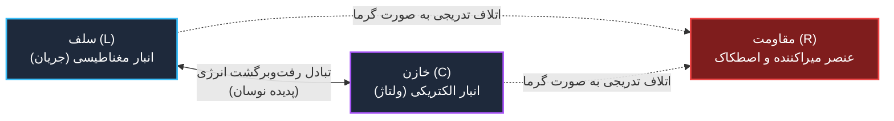
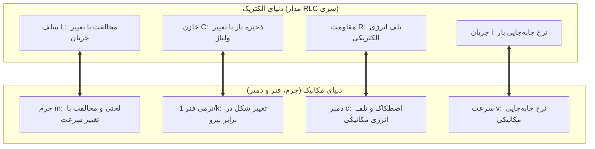
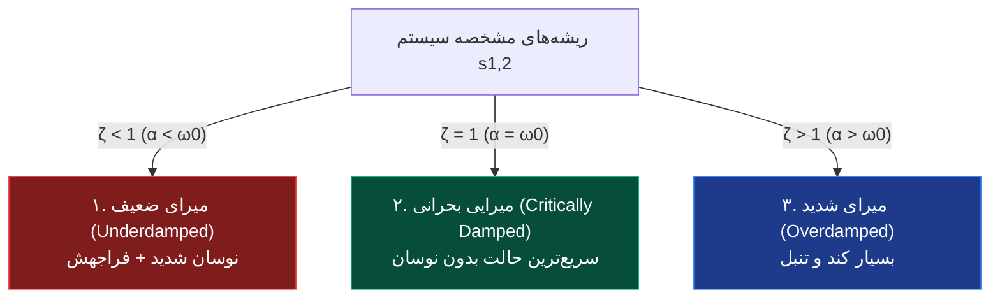
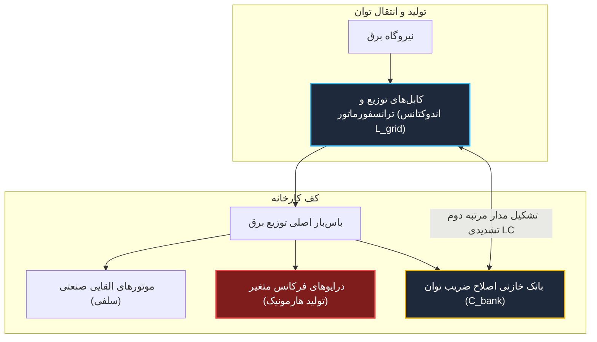
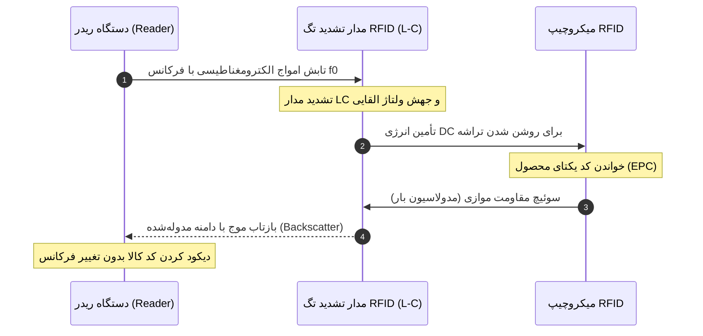
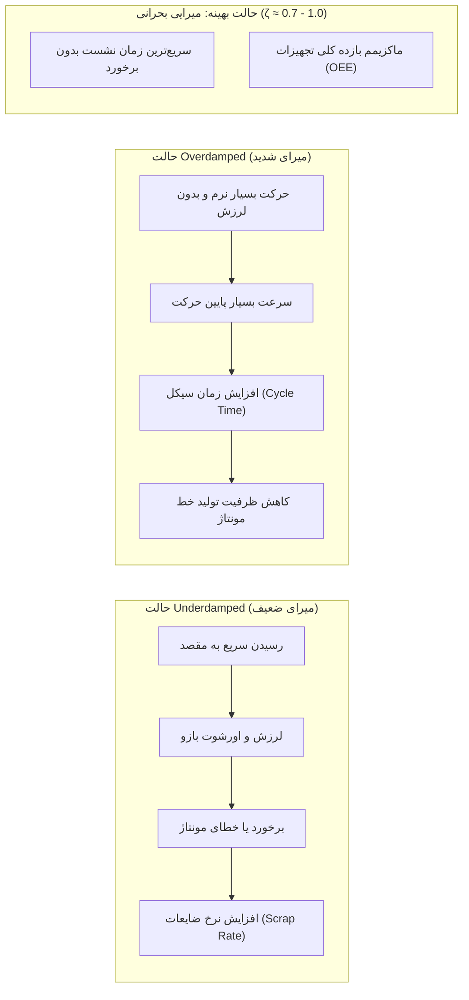

# از مدار تا زنجیره تأمین: کاربردهای مدارهای مرتبه دوم در صنعت و مهندسی صنایع

> **ایده محوری برای ارائه:**  
> وقتی دانشجویان مهندسی صنایع یا مکانیک برای اولین بار با معادلات دیفرانسیل مدارهای مرتبه دوم ($RLC$) روبه‌رو می‌شوند، اغلب آن را مبحثی صرفاً برقی و انتزاعی می‌پندارند. اما واقعیت این است که **معادلات مرتبه دوم، زبان بنیادین توصیف رفتار تمام سیستم‌های پویا در جهان فیزیکی و کسب‌وکار هستند**؛ از تنظیم میرایی بازوی رباتیک جوشکاری در خط تولید تا مهار نوسانات مرگبار موجودی انبار در زنجیره تأمین جهانی!

---

## مقدمه و شهود فیزیکی: چرا مدارهای مرتبه دوم منحصربه‌فردند؟

در مهندسی برق، مدارها بر اساس مرتبه معادله دیفرانسیل حاکم بر آن‌ها دسته‌بندی می‌شوند:

* **مدارهای مرتبه اول ($RC$ یا $RL$):**  
  تنها یک عنصر ذخیره‌کننده انرژی (فقط خازن یا فقط سلف) دارند. پاسخ گذرا در این مدارها کاملاً **یکنواخت (Monotonic)** است؛ یعنی ولتاژ یا جریان به صورت نمایی ($e^{-t/\tau}$) شارژ یا دشارژ می‌شود. در این مدارها **هیچ‌گاه نوسان، رفت‌وبرگشت یا فراجهش (Overshoot)** رخ نمی‌دهد.
* **مدارهای مرتبه دوم ($RLC$):**  
  حداقل شامل **دو انبار انرژی ناهمجنس و مکمل** هستند:
  1. **سلف ($L$):** انرژی را به صورت میدان مغناطیسی بر پایه جریان ذخیره می‌کند ($E_L = \frac{1}{2} L i^2$).
  2. **خازن ($C$):** انرژی را به صورت میدان الکترواستاتیکی بر پایه ولتاژ ذخیره می‌کند ($E_C = \frac{1}{2} C v^2$).

همین حضور دو انبار ناهمجنس باعث پدیده‌ای شبیه به **آونگ (پاندول)** می‌شود: انرژی مانند آبی که در یک تشت به چپ و راست حرکت می‌کند، مدام بین سلف و خازن دست‌به‌دست می‌شود. اگر مقاومت ($R$) در مدار نباشد، این تبادل تا ابد ادامه می‌یابد (نوسان نامیرا)؛ و اگر مقاومت وجود داشته باشد، این انرژی به تدریج به حرارت تبدیل شده و نوسان میرا می‌گردد.

---

### هم‌ارزی کامل با سیستم مکانیکی جرم، فنر و کمک‌فنر (Mass-Spring-Damper)

یکی از قدرتمندترین روش‌های فهم مهندسی، **قیاس سیستم‌ها (System Analogy)** است. مدار الکتریکی $RLC$ دقیقاً کپی مو‌به‌موی سیستم مکانیکی **جرم، فنر و دمپر** است:

| کمیت الکتریکی (مدار $RLC$ سری) | فرمول الکتریکی | کمیت مکانیکی متناظر (جرم-فنر-دمپر) | فرمول مکانیکی | مفهوم فیزیکی مشترک |
| :--- | :---: | :--- | :---: | :--- |
| **سلف ($L$)** | $v_L = L \frac{di}{dt}$ | **جرم ($m$)** | $F_m = m \frac{dv}{dt}$ | **لختی و اینرسی:** تمایل به حفظ وضعیت فعلی و مقاومت در برابر تغییر ناگهانی جریان/سرعت |
| **خازن ($C$)** | $v_C = \frac{1}{C} q$ | **نرمی فنر ($\frac{1}{k}$)** | $F_k = k x \implies x = \frac{1}{k} F$ | **انعطاف‌پذیری و کشسانی:** ظرفیت انباشت انرژی پتانسیل بر اثر جابه‌جایی بار/تغییر مکان |
| **مقاومت ($R$)** | $v_R = R i$ | **دمپر ویسکوز ($c$)** | $F_c = c v$ | **اتلاف و میرایی:** اصطکاک و تبدیل انرژی جنبشی/الکتریکی به گرما |
| **بار الکتریکی ($q$)** | $i = \frac{dq}{dt}$ | **جابه‌جایی ($x$)** | $v = \frac{dx}{dt}$ | متغیر حالت اصلی سیستم |
| **جریان الکتریکی ($i$)** | نرخ جریان بار | **سرعت ($v$)** | نرخ تغییر موقعیت | شارش حالت |
| **ولتاژ منبع ($e(t)$)** | نیرو‌محرکه الکتریکی | **نیروی خارجی ($F(t)$)** | تحریک مکانیکی | ورودی محرک سیستم |

#### مقایسه فرکانس طبیعی نوسان ($\omega_0$)
در هر دو سیستم، فرکانس طبیعی بدون اتلاف دقیقاً از یک ساختار ریاضی تبعیت می‌کند:

$$\omega_{0, \text{Electric}} = \frac{1}{\sqrt{LC}} \quad \longleftrightarrow \quad \omega_{0, \text{Mechanical}} = \sqrt{\frac{k}{m}} = \frac{1}{\sqrt{m \cdot (1/k)}}$$

* **افزایش سلف ($L$) یا جرم ($m$):** سیستم را سنگین و پرلختی می‌کند؛ فرکانس نوسانات پایین می‌آید و واکنش سیستم به تغییرات تنبل‌تر می‌شود.
* **افزایش خازن ($C$) یا نرم‌تر شدن فنر ($1/k$):** سیستم منعطف‌تر می‌شود؛ فرکانس کاهش می‌یابد و برای رسیدن به تعادل جابه‌جایی بیشتری نیاز است.
* **افزایش مقاومت ($R$) یا دمپر ($c$):** نوسانات را سرکوب می‌کند؛ اما اگر بیش از حد بزرگ شود، حرکت سیستم را خفه و قفل می‌کند.

---

## سه رژیم رفتاری پاسخ گذرا: کلید طلایی طراحی مهندسی

معادله دیفرانسیل حاکم بر مدار $RLC$ سری به صورت زیر است:

$$L \frac{d^2 i}{dt^2} + R \frac{di}{dt} + \frac{1}{C} i = 0 \implies \frac{d^2 i}{dt^2} + 2\alpha \frac{di}{dt} + \omega_0^2 i = 0$$

که در آن:
* **فرکانس طبیعی نامیرا:** $\omega_0 = \frac{1}{\sqrt{LC}}$
* **ضریب میرایی نپر:** $\alpha = \frac{R}{2L}$
* **نسبت میرایی (Damping Ratio):** $\zeta = \frac{\alpha}{\omega_0} = \frac{R}{2} \sqrt{\frac{C}{L}}$

ریشه‌های معادله مشخصه عبارتند از:

$$s_{1, 2} = -\alpha \pm \sqrt{\alpha^2 - \omega_0^2} = -\zeta\omega_0 \pm \omega_0 \sqrt{\zeta^2 - 1}$$

بسته به مقدار نسبت میرایی ($\zeta$)، سه رژیم رفتاری کاملاً متمایز پدید می‌آید:

### مقایسه دقیق سه رژیم میرایی

| ویژگی مهندسی | میرای ضعیف (Underdamped) | میرایی بحرانی (Critically Damped) | میرای شدید (Overdamped) |
| :--- | :---: | :---: | :---: |
| **شرط نسبت میرایی** | $\zeta < 1 \quad (\alpha < \omega_0)$ | $\zeta = 1 \quad (\alpha = \omega_0)$ | $\zeta > 1 \quad (\alpha > \omega_0)$ |
| **ماهیت ریشه‌ها** | مختلط مزدوج ($-\alpha \pm j\omega_d$) | حقیقی مضاعف ($-\alpha, -\alpha$) | حقیقی متمایز منفی ($s_1, s_2$) |
| **فرکانس نوسان** | $\omega_d = \sqrt{\omega_0^2 - \alpha^2}$ | نوسان وجود ندارد | نوسان وجود ندارد |
| **فرم ریاضی پاسخ** | $e^{-\alpha t} \left[ A_1 \cos(\omega_d t) + A_2 \sin(\omega_d t) \right]$ | $(A_1 + A_2 t) e^{-\alpha t}$ | $A_1 e^{s_1 t} + A_2 e^{s_2 t}$ |
| **فراجهش (Overshoot)** | دارد (گاهی تا ۱۰۰٪ مقدار پله!) | **دقیقاً صفر** | **دقیقاً صفر** |
| **زمان رسیدن به تعادل** | طولانی (به دلیل ارتعاش مداوم) | **کوتاه‌ترین زمان ممکن** | بسیار طولانی (به دلیل لختی اتلافی) |
| **تشبیه روزمره** | کمک‌فنر خراب ماشین (اتومبیل بالا و پایین می‌پرد) | در بازشوی استاندارد بیمارستان (سریع بسته می‌شود بدون کوبیده شدن) | در آغشته به گریس غلیظ (به سختی و با زور بسته می‌شود) |

---

### تله مهندسی (The Engineering Trap)

> [!WARNING] یک اشتباه رایج میان دانشجویان مهندسی
> یک باور غلط شهودی این است که: *«اگر مقاومت نوسان را کم می‌کند، پس هر چه مقاومت ($R$) یا ضریب اصطکاک را بالاتر ببریم، سیستم سریع‌تر آرام می‌گیرد و زودتر به حالت ماندگار می‌رسد!»*  
> **این یک تله خطرناک است!**
> 
> افزایش مقاومت فقط و فقط تا نقطه **میرایی بحرانی ($\zeta = 1$)** زمان نشست را کوتاه می‌کند. به محض اینکه از مرز $\zeta = 1$ عبور کنید و وارد رژیم Overdamped شوید، یکی از ریشه‌های معادله مشخصه به سمت صفر میل می‌کند ($s_1 \to 0$). این ریشه به **«قطب کند غالب (Dominant Slow Pole)»** تبدیل شده و باعث می‌شود سیستم برای رسیدن به ۲ درصد نهایی، زمان بسیار بیشتری تلف کند!

---

## آزمایشگاه تعاملی: شبیه‌ساز پاسخ پله مدار RLC

با استفاده از اسلایدرهای زیر مقادیر مقاومت ($R$)، سلف ($L$) و خازن ($C$) را تغییر دهید و پاسخ پله ولتاژ خازن ($v_C(t)$) را به همراه نسبت میرایی ($\zeta$) و وضعیت پایداری سیستم به صورت زنده مشاهده کنید:

  

    

      حالت‌های پیش‌فرض:
      <button class="rlc-btn" id="presetUnder">میرای ضعیف (Underdamped)</button>
      <button class="rlc-btn rlc-btn-active" id="presetCritical">میرایی بحرانی (Critical)</button>
      <button class="rlc-btn" id="presetOver">میرای شدید (Overdamped)</button>
    

    

      

        

          مقاومت ($R$):
          <strong id="valR">200</strong> $\Omega$
        

        <input type="range" id="sliderR" min="10" max="600" step="5" value="200" class="rlc-range">
      

      

        

          سلف ($L$):
          <strong id="valL">50</strong> $mH$
        

        <input type="range" id="sliderL" min="10" max="200" step="5" value="50" class="rlc-range">
      

      

        

          خازن ($C$):
          <strong id="valC">5.0</strong> $\mu F$
        

        <input type="range" id="sliderC" min="0.5" max="25" step="0.5" value="5" class="rlc-range">
      

    

    

      

        نسبت میرایی ($\zeta$):
        <strong class="rlc-metric-val" id="metricZeta">1.00</strong>
      

      

        فرکانس طبیعی ($\omega_0$):
        <strong class="rlc-metric-val" id="metricW0">2000 rad/s</strong>
      

      

        وضعیت رژیم:
        میرایی بحرانی (بهینه)
      

      

        درصد فراجهش ($M_p$):
        <strong class="rlc-metric-val" id="metricOvershoot">0%</strong>
      

    

  

  

    <canvas id="rlcCanvas" width="850" height="400"></canvas>
  

---

## کاربردهای مستقیم در کف کارخانه (نگاه سخت‌افزاری)

### ۱. اصلاح ضریب توان، بانک خازنی و فاجعه تشدید هارمونیکی

در کارخانجات و شهرک‌های صنعتی، عمده مصرف‌کنندگان انرژی الکتریکی بارهای سلفی سه‌فاز هستند: **موتورهای القایی، ترانسفورماتورها و کوره‌های قوس**. این تجهیزات برای ایجاد شار مغناطیسی به **توان راکتیو ($Q$)** نیاز دارند.

> **شهود مهندسی توان راکتیو:**  
> توان راکتیو مانند **حباب‌های هوای داخل یک لوله آب** است؛ نه تشنگی را رفع می‌کند و نه کار مکانیکی انجام می‌دهد، اما فضای مفید لوله‌کشی و ظرفیت پمپ‌ها را اشغال می‌کند! یا مانند **کامیون‌های خالی** که مدام میان نیروگاه و کارخانه در رفت‌وآمدند و ظرفیت ترافیکی کابل‌ها و پست‌های برق را هدر می‌دهند.  
> اگر ضریب توان ($\cos\phi$) کارخانه از $0.9$ پایین‌تر بیاید، وزارت نیرو جریمه‌های سنگینی به نام **جریمه توان راکتیو** در قبض برق منظور می‌کند!

#### تولد مدار مرتبه دوم در دل کارخانه
برای حذف این جریمه، مهندسان صنایع و برق یک **بانک خازنی ($C_{\text{bank}}$)** در تابلوی توزیع اصلی کارخانه نصب می‌کنند تا توان راکتیو مورد نیاز موتورها به صورت محلی تأمین شود و به شبکه سرریز نکند.  
اما در همین لحظه، یک سیستم مرتبه دوم پنهان متولد می‌شود:
* سلف معادل شبکه و ترانسفورماتور پست برق ($L_{\text{grid}}$)
* بانک خازنی کارخانه ($C_{\text{bank}}$)

فرکانس تشدید طبیعی این شبکه صنعتی برابر است با:

$$f_{\text{res}} = \frac{1}{2\pi \sqrt{L_{\text{grid}} C_{\text{bank}}}}$$

#### خطر مرگبار هم‌فرکانسی با هارمونیک‌ها
امروزه در خطوط تولید مدرن، ده‌ها درایو کنترل دور موتور (VFD)، اینورتر و ربات وجود دارند که به دلیل سوئیچینگ الکترونیک قدرت، **هارمونیک‌های ولتاژ و جریان** (به‌ویژه هارمونیک‌های پنجم ۲۵۰Hz و هفتم ۳۵۰Hz) تولید می‌کنند.  
اگر تصادفاً فرکانس تشدید مدار کارخانه ($f_{\text{res}}$) روی یکی از این هارمونیک‌ها بیفتد:
1. امپدانس معادل مدار $LC$ در فرکانس تشدید به شدت سقوط می‌کند یا جریان به بی‌نهایت میل می‌کند!
2. جریان‌های صدها آمپری هارمونیکی در بانک خازنی جاری می‌شوند.
3. **پیامد فاجعه‌بار:** باد کردن و ترکیدن باتری‌های خازنی، آتش‌سوزی در تابلوی برق، ذوب شدن شینه‌های مسی و قطعی کامل خط تولید کارخانه!

#### راه‌حل مهندسی: راکتور دیتیون (Detuned Reactor)
برای نجات کارخانه، مهندسان با هر خازن یک سلف کوچک به نام **راکتور فیلتر دیتیون ($L_{\text{detune}}$)** به صورت سری متصل می‌کنند تا فرکانس تشدید کل مدار مرتبه دوم را عمداً به زیر فرکانس کمترین هارمونیک موجود (مثلاً روی ۱۸۹ هرتز یا ۴.۲ برابر فرکانس پایه) جابه‌جا کنند. با این کار، سیستم برای تمام هارمونیک‌های صنعتی خاصیت سلفی پیدا کرده و امکان وقوع تشدید ناممکن می‌شود.

---

### ۲. تگ‌های RFID در انبارهای هوشمند و لجستیک

در کارخانجات خودروسازی، انبارداری هوشمند آمازون و مدیریت زنجیره تأمین، از برچسب‌های **RFID پسیو (Passive RFID Tags)** برای ردیابی آنی پالت‌ها و قطعات استفاده می‌شود. این تگ‌ها نه باتری دارند و نه سیم برق! پس چگونه داده‌ها را مخابره می‌کنند؟

1. **جذب توان بی‌سیم از طریق مدار تشدید $LC$:**  
   درون تگ یک سیم‌پیچ کوچک (سلف $L$) با یک خازن میکروسکوپی ($C$) مدار مرتبه دوم هماهنگ با فرکانس کاری ریدر (مثلاً $13.56\text{ MHz}$) می‌سازند. با عبور پالت از برابر آنتن ریدر، پدیده **تشدید (Resonance)** رخ می‌دهد؛ ولتاژ القایی دو سر خازن ناگهان به چندین ولت می‌رسد، یکسو شده و چیپ چند میلی‌واتی را روشن می‌کند.
2. **مدولاسیون بار (Load Modulation / Backscattering):**  
   تگ برای ارسال پاسخ، فرستنده رادیویی پرمصرف ندارد؛ بلکه تراشه، یک مقاومت کوچک را به صورت متناوب با مدار $LC$ موازی یا قطع می‌کند. تغییر امپدانس در مدار تشدید تگ، باعث تغییر در ضریب بازتاب میدان الکترومغناطیسی روی آنتن ریدر می‌شود. ریدر این تغییرات دامنه را خوانده و کد محصول را استخراج می‌کند!

---

### ۳. کوره‌های گرمایش القایی و شارژ بی‌سیم ربات‌های انبار (AGV)

در صنایع فولاد، عملیات حرارتی، فرم‌دهی قطعات خودرو و خطوط تولید لوله‌های فلزی، به جای کوره‌های سنتی گازسوز و پردود، از **کوره‌های القایی (Induction Heating)** استفاده می‌شود.

* **نحوه کارکرد:** جریان متناوب فرکانس بالا (از چند کیلوهرتز تا چند مگاهرتز) از یک کویل مسی عبور می‌کند و میدان مغناطیسی شدیدی درون شمش فولادی القا می‌نماید. این میدان، جریان‌های گردابی پرقدرت فوکو (Eddy Currents) درون فلز به راه می‌اندازد و بر اثر مقاومت اهمی قطعه، در عرض چند ثانیه فولاد را سرخ و گداخته می‌کند!
* **نقش مدار مرتبه دوم:** چون کویل کوره یک سلف خالص ($L$) با ضریب توان بسیار پایین است، اتصال مستقیم آن به شبکه برق نیازمند ژنراتورهای نجومی خواهد بود. با موازی کردن یک بانک خازنی باکیفیت ($C$) با کویل، یک مدار تانک تشدیدی ($LC$ Tank) ساخته می‌شود. سیستم دقیقاً در **فرکانس تشدید** راه‌اندازی می‌گردد؛ در این حالت جریان مصرفی از منبع تغذیه به حداقل ممکن می‌رسد و ضریب توان معادل مدار دقیقاً $1.0$ خواهد بود.
* **شارژ بی‌سیم ربات‌های خودران (AGV):**  
  در انبارهای مدرن لجستیک، ربات‌های AGV برای شارژ شدن نیازی به سوکت فیزیکی ندارند. یک پد فرستنده در کف زمین و یک پد گیرنده زیر ربات قرار دارد. مدار فرستنده و گیرنده هر دو روی یک فرکانس تشدید مشترک هماهنگ می‌شوند (Resonant Inductive Coupling) تا انتقال ده‌ها کیلووات توان در فاصله چند سانتی‌متری هوا با راندمان بالاتر از ۹۲ درصد امکان‌پذیر گردد.

---

### ۴. مدارهای اسنابر (Snubber Circuits) در حفاظت کلیدهای صنعتی

هنگامی که یک کنتاکتور بزرگ، رله الکترومکانیکی، ترانزیستور ماسفت یا ماژول IGBT موتور یک نوار نقاله را خاموش می‌کند، جریان سلفی بار به صورت ناگهانی قطع می‌شود. طبق رابطه ولتاژ سلف:

$$v_L = L \frac{di}{dt}$$

چون زمان قطع ($dt$) در نیمه‌هادی‌ها در حد چند نانوثانیه است، شیب تغییرات جریان ($\frac{di}{dt}$) به بی‌نهایت میل کرده و یک **پیک ولتاژ ضربه‌ای وحشتناک (چندین هزار ولت)** روی کنتاکت‌ها ایجاد می‌شود که باعث ایجاد جرقه شدید (Arcing)، فرسایش فیزیکی یا سوختن کامل سوییچ الکترونیکی می‌گردد!

مهندسان با موازی کردن یک **مدار اسنابر $RC$** با سوییچ، مدار مرتبه دومی طراحی می‌کنند که:
1. نرخ افزایش ولتاژ دو سر کلید ($\frac{dv}{dt}$) را محدود سازد.
2. انرژی ذخیره‌شده در میدان مغناطیسی سلف کابل‌ها را در خازن جذب کرده و در مقاومت اسنابر در رژیم **میرایی بحرانی** تخلیه نماید تا از هرگونه نوسان القایی جلوگیری شود.

---

## مدل‌سازی دینامیکی سیستم‌ها در مهندسی صنایع

### ۱. رباتیک و اتوماسیون خطوط مونتاژ: بهینه‌سازی توازن میان زمان سیکل و ضایعات

در ایستگاه‌های جوشکاری رباتیک، برش لیزری یا برداشتن و گذاشتن قطعات (Pick-and-Place)، بازوی رباتیک با یک سیستم محرک الکتریکی (موتور سروو و گیربکس) حرکت داده می‌شود. رفتار حرکتی بازوی ربات دقیقاً از معادله دینامیکی مرتبه دوم تبعیت می‌کند:

$$J \frac{d^2 \theta}{dt^2} + B \frac{d\theta}{dt} + K \theta = \tau(t)$$

که در آن $J$ ممان اینرسی بازو، $B$ ضریب میرایی و اصطکاک و $K$ صلبیت و سختی مکانیکی بازوست.

* **اگر کنترلر در حالت میرای ضعیف ($\zeta < 1$) باشد:** بازو سریع حرکت می‌کند، اما در نقطه توقف دچار لرزش مکانیکی (Ringing) می‌شود. این لرزش باعث برخورد قطعه کار، فرسایش مفاصل ربات و افزایش نرخ ضایعات (Scrap Rate) می‌شود.
* **اگر کنترلر در حالت میرای شدید ($\zeta > 1$) باشد:** هیچ‌گونه لرزشی رخ نمی‌دهد، اما ربات به شدت کند عمل می‌کند؛ در نتیجه زمان سیکل تولید (Cycle Time) بالا رفته و گلوگاه خط کندتر می‌شود.
* **تصمیم بهینه مهندسی صنایع:** مهندس صنایع به کمک مهندس کنترل، پارامترهای کنترلر (PID) را روی **میرایی بحرانی ($\zeta = 1$) یا میرایی بهینه با ضریب $\zeta \approx 0.7$** تنظیم می‌کند تا کمترین زمان نشست ممکن با تضمین عدم برخورد حاصل شود.

---

### ۲. مدل‌سازی زنجیره تأمین و اثر شلاقی (Bullwhip Effect) به عنوان مدار RLC

یکی از شاهکارهای پیوند مهندسی برق با دینامیک سیستم‌ها (System Dynamics) در مهندسی صنایع، **تحلیل اثر شلاقی در زنجیره تأمین به عنوان یک مدار $RLC$ مرتبه دوم** است.

> **اثر شلاقی (Bullwhip Effect) چیست؟**  
> پدیده‌ای که در آن تغییرات و نوسانات کوچک در تقاضای مصرف‌کننده نهایی در بازار، هر چه به لایه‌های بالاتر زنجیره (توزیع‌کننده $\to$ کارخانه $\to$ تأمین‌کننده مواد خام) حرکت می‌کند، با ضریب فزاینده و غیرقابل کنترلی بزرگ‌تر می‌شود.

#### جدول تناظر مفاهیم زنجیره تأمین با مدار RLC

| کمیت در مدار | مفهوم در زنجیره تأمین | نقش و رفتار دینامیکی |
| :---: | :--- | :--- |
| **سلف ($L$)** | **زمان تدارک و لختی تولید (Lead Time)** | همان‌طور که سلف اجازه تغییر ناگهانی جریان را نمی‌دهد، زمان ساخت، حمل‌ونقل و لختی ماشین‌آلات نیز مانع از تنظیم آنی ظرفیت تولید می‌شوند. |
| **خازن ($C$)** | **ظرفیت انبار و موجودی اطمینان (Buffer)** | جریان ورودی کالا منهای جریان خروجی، در انبار جمع می‌شود ($q = \int (i_{in} - i_{out})dt$)؛ دقیقاً مشابه انباشت بار الکتریکی در خازن. |
| **مقاومت ($R$)** | **سیاست‌های هموارسازی (Order Smoothing)** | میزان بازدارندگی مدیران از واکنش‌های آنی به نوسانات مقطعی و سیاست‌های احتیاطی در تبادل شفاف اطلاعات. |
| **ولتاژ ($v_C$)** | **سطح موجودی انبار (Inventory Level)** | متغیر کلیدی سیستم که نوسان آن موجب خسارت به سیستم می‌شود. |

#### چرا زنجیره تأمین مانند یک مدار مرتبه دوم نوسان می‌کند؟
وقتی تقاضای بازار ناگهان افزایش می‌یابد (ورودی پله):
1. به دلیل **لختی و زمان تدارک (سلف $L$)**، کارخانه بلافاصله نمی‌تواند کالا تحویل دهد؛ پس موجودی انبارها افت می‌کند و خطر کمبود کالا (Stockout) شکل می‌گیرد.
2. مدیران زنجیره تأمین وحشت‌زده می‌شوند و سفارش‌های دوچندان ثبت می‌کنند.
3. پس از گذشت زمان تأخیر ($L$)، حجم عظیمی از کالاهای سفارش داده شده ناگهان وارد انبارها می‌شوند (**خازن $C$ پر می‌شود**).
4. این بار سیستم دچار **فراجهش موجودی (Inventory Overshoot)** می‌شود و انبارها پر از کالای مازاد و خواب سنگین سرمایه می‌گردند!
5. مدیران سفارش‌ها را لغو می‌کنند؛ خط تولید خاموش می‌شود تا انبار خالی شود، و مجدداً کمبود رخ می‌دهد!

این پدیده دقیقاً پاسخ **میرای ضعیف (Underdamped)** یک مدار مرتبه دوم است. تنها راه رهایی از این تله، افزایش مقاومت کنترلی ($R$) از طریق **شفافیت داده‌ها (سیستم‌های ERP و اشتراک‌گذاری لحظه‌ای تقاضای POS)** و بهینه‌سازی سیستم به سوی **میرایی بحرانی** است.

---

## جمع‌بندی در یک نگاه (Executive Summary)

برای ارائه سریع و مرور مفهومی در آزمون‌ها یا جلسات کاری، ماتریس زیر خلاصه‌ای جامع از پل ارتباطی میان برق، مکانیک و مهندسی صنایع را به نمایش می‌گذارد:

| بعد مقایسه | مهندسی برق (مدار $RLC$) | مهندسی مکانیک (جرم-فنر-دمپر) | مهندسی صنایع (زنجیره تأمین) |
| :--- | :--- | :--- | :--- |
| **عنصر لختی و اینرسی** | سلف ($L$) | جرم و اینرسی ($m$) | زمان انتظار تأمین و ساخت (Lead Time) |
| **عنصر انباشت و ظرفیت** | خازن ($C$) | نرمی فنر ($\frac{1}{k}$) | ظرفیت ذخیره‌سازی انبار (Inventory Capacity) |
| **عنصر میراکننده و اتلاف** | مقاومت ($R$) | اصطکاک و دمپر ($c$) | سیاست هموارسازی سفارش‌ها و شفافیت اطلاعات |
| **پاسخ میرای ضعیف ($\zeta < 1$)** | نوسان ولتاژ، اسپایک و تشدید خطرناک | ارتعاش و کوبش مکانیکی، لرزش بازوی ربات | اثر شلاقی، تاب خوردن میان کمبود و انباشت مازاد |
| **پاسخ میرای شدید ($\zeta > 1$)** | رسیدن کند و تنبل به مقدار هدف | حرکت بسیار سنگین و قفل‌شونده | زمان سیکل طولانی، تأخیرهای مزمن در تحویل |
| **پاسخ میرایی بحرانی ($\zeta = 1$)** | سریع‌ترین صعود بدون حتی یک ولت اورشوت | نرم‌ترین و سریع‌ترین حرکت بازوی ربات | حداقل هزینه کل (تعادل میان خواب کالا و سفارش) |

---

#مهندسی_برق #مدار_مرتبه_دوم #مهندسی_صنایع #زنجیره_تأمین #اتوماسیون_صنعتی #اثر_شلاقی #تشدید #دانشگاه
