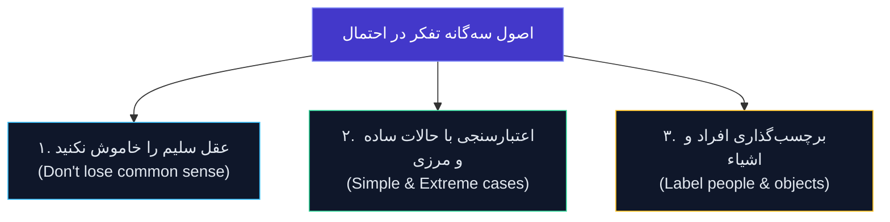

# اصول سه‌گانه تفکر و حل مسئله در احتمال

> **سخنی از سر کلاس Stat 110 هاروارد:**  
> «دروس ریاضیات معمولی به شما یاد می‌دهند چگونه با قواعد سفت‌وسخت فرمول‌ها جلو بروید؛ اما در نظریه احتمال، اگر فقط به فرمول‌ها تکیه کنید و شهود خود را خاموش کنید، با اطمینان کامل به پاسخ‌هایی می‌رسید که کاملاً بی‌پایه‌اند! برای نجات از این دام، به سه عادت ذهنی همیشگی نیاز دارید.»  
> — **پروفسور جو بلیتزستین (Joe Blitzstein)**

---

## چرا احتمال ذهن ما را فریب می‌دهد؟

نظریه احتمال یکی از معدود شاخه‌های ریاضیات است که در آن «شهود طبیعی انسان» مرتباً به بیراهه می‌رود. مغز ما برای ارزیابی شانس و ترکیبیات در فضاهای چندبعدی تکامل نیافته است.  

وقتی با مسئله‌ای ترکیبیاتی یا آماری روبه‌رو می‌شویم، دو اشتباه رایج رخ می‌دهد:
1. **فرمول‌زدگی مفرط:** دانشجو بدون تجسم مسئله، نمادهای ترکیب و جایگشت را پشت سر هم ردیف می‌کند.
2. **پذیرش پاسخ‌های غیرمنطقی:** چون مراحل جبری شیک به نظر می‌رسند، پاسخ نهایی هرگز راستی‌آزمایی نمی‌شود.

پروفسور بلیتزستین برای مصون ماندن از این خطاها، سه اصل طلایی را روی تخته تدوین می‌کند که به **«قوانین تفکر بلیتزستین»** مشهورند:



---

## عقل سلیم را خاموش نکنید (Don't Lose Common Sense)

اولین و مهم‌ترین قانون این است: **هیچ‌گاه پشت نمادهای جبری پنهان نشوید.**  

بارها دیده شده که دانشجویی در انتهای یک محاسبه طولانی به عددی مثل $1.42$ یا $-0.15$ برای احتمال یک پیشامد می‌رسد و آن را با کمال آرامش درون کادر پاسخ می‌نویسد! در حالی که بدیهی‌ترین اصل احتمال این است:

$$0 \le P(A) \le 1$$

اگر پاسخ شما این بازه را نقض کرد یا با منطق فیزیکی مسئله در تضاد بود، بلافاصله زنگ خطر را به صدا درآورید.

### ماجرای نماد $\binom{52}{5}$ و پاسخ‌های خود‌تبیین‌گر (`Self-Annotating`)

روی تخته کلاس، بلیتزستین می‌نویسد:

$$\binom{52}{5} \leftarrow \text{leave} \quad , \quad \frac{4}{2 \cdot 1} = 2$$

این یادداشت دو پیام کلیدی دارد:

1. **لازم نیست اعداد بزرگ را محاسبه کنید (`Leave it!`):**  
   اگر در یک مسئله پوکر یا دست کارت، به عبارت $\binom{52}{5}$ رسیدید، رهایش کنید! نیازی نیست وقت باارزش امتحان را صرف ضرب و تقسیم‌های خسته‌کننده کنید تا به عدد $2,598,960$ برسید.  
   * چرا؟ چون عدد خام $2,598,960$ هیچ قصه‌ای تعریف نمی‌کند و احتمال خطای محاسباتی دستی در آن بسیار بالاست؛ اما نماد $\binom{52}{5}$ **خود‌تبیین‌گر (Self-Annotating)** است؛ یعنی خودش فریاد می‌زند که «ما ۵ کارت از بین ۵۲ کارت انتخاب کرده‌ایم».
2. **اما مضحک نباشید!**  
   اگر به عبارتی ساده مثل $\frac{4}{2 \cdot 1}$ رسیدید، آن را رها نکنید؛ بدیهی است که باید بلافاصله بنویسید $2$. مرز میان «ساده‌سازی مفید» و «اتلاف وقت در محاسبات عددی بی‌خاصیت» را با عقل سلیم تشخیص دهید.

---

## اعتبارسنجی با حالت‌های ساده و مرزی (Simple & Extreme Cases)

یکی از مرگبارترین ویژگی‌های مسائل ترکیبیات این است که ممکن است پاسخی کاملاً اشتباه به دست آورید، اما فرمول شما بسیار تمیز، متقارن و جذاب به نظر برسد!

چگونه فرمول خود را در چند ثانیه تست کنیم؟ با دو سلاح قدرتمند:

### ۱. حالت‌های فوق‌العاده ساده (`Simple Cases`)
به متغیرهای مسئله مقادیر بسیار کوچک مثل $n = 1$ یا $n = 2$ بدهید؛ حالاتی که می‌توانید جواب آن‌ها را با انگشتان دست یا رسم روی کاغذ در ۱۰ ثانیه بشمارید.  
اگر فرمول شما برای $n = 1$ عددی متفاوت از واقعیت داد، بدون شک فرمول کلی غلط است و نیازی نیست وقت صرف ادامه آن کنید.

### ۲. حالت‌های حدی و اکستریم (`Extreme Cases`)
متغیرها را به مرزهای نهایی‌شان هل دهید:
* **حالت صفر ($k = 0$):** اگر هیچ انتخابی انجام ندهیم، آیا فرمول عدد ۱ (یک حالت: تهی) را پس می‌دهد؟
* **حالت برابری ($k = n$):** اگر همه افراد را برداریم چه؟ آیا جواب معقول است؟
* **حالت ناممکن ($k > n$ بدون جایگذاری):** اگر از یک ظرف ۵تایی بخواهیم ۶ مهره بدون جایگذاری برداریم، آیا فرمول صفر می‌شود؟

#### نمونه عملی: تست فرمول خط و توپ در مرزها
فرمول پاسخ‌های نامنفی معادله $x_1 + \dots + x_n = k$ برابر بود با:

$$\binom{n + k - 1}{k}$$

بیایید آن را با حالت‌های مرزی به چالش بکشیم:
* فرض کنید $k = 0$ (می‌خواهیم صفر شیء را بین $n$ نفر تقسیم کنیم):  
  $$\binom{n + 0 - 1}{0} = \binom{n - 1}{0} = 1$$  
  دقیقاً ۱ حالت وجود دارد: به همه صفر شیء می‌رسد ($0+0+\dots+0=0$). فرمول سربلند بیرون آمد!
* فرض کنید $n = 1$ (فقط ۱ نفر داریم و $k$ شیء):  
  $$\binom{1 + k - 1}{k} = \binom{k}{k} = 1$$  
  تنها ۱ حالت وجود دارد: تمام $k$ شیء به همان یک نفر می‌رسد ($x_1 = k$). کاملاً درست است!

---

## برچسب‌گذاری افراد و اشیاء (Label People and Objects)

این شاید **عمیق‌ترین و بنیادی‌ترین اصل در کل علم احتمال کلاسیک** باشد.  

> **قانون طلایی بلیتزستین:**  
> حتی اگر صورت مسئله صریحاً بگوید اشیاء، سکه‌ها یا افراد «کاملاً یکسان و غیرقابل تمایزند»، در ذهن و محاسبات خود **همیشه و همیشه به آن‌ها برچسب‌های متمایز بزنید ($1, 2, 3, \dots$)**.

### چرا برچسب‌گذاری حیاتی است؟ (راز فضای نمونه هم‌شانس)

یادآوری از تعریف نایو احتمال:

$$P(A) = \frac{|A|}{|S|}$$

این فرمول **تنها و تنها زمانی معتبر است که تمام برآمدهای فضای نمونه $S$ شانس برابر داشته باشند (Equally Likely Outcomes)**.  
اگر اشیاء را یکسان فرض کنید، فضای نمونه‌ای می‌سازید که برآمدهایش هم‌شانس نیستند و فرمول کسر احتمال فرو می‌ریزد!

### مثال کلاسیک: پرتاب دو سکه یکسان

دو سکه کاملاً مشابه از نظر فیزیکی را هم‌زمان پرتاب می‌کنیم. احتمال اینکه «یک شیر و یک خط» ظاهر شود چقدر است؟

* **رویکرد اشتباه (بدون برچسب):**  
  شخص می‌گوید چون سکه‌ها یکسانند، برآمدهای ممکن ۳ حالت بیشتر نیستند:
  $$S_{\text{غلط}} = \{\text{دو شیر}, \text{یک شیر و یک خط}, \text{دو خط}\}$$
  سپس نتیجه می‌گیرد که احتمال یک شیر و یک خط برابر با $\frac{1}{3}$ است!

* **رویکرد درست (با برچسب‌گذاری فرضی: سکه A و سکه B):**  
  طبیعت سکه A را از سکه B تشخیص می‌دهد، حتی اگر چشمان ما تشخیص ندهد:
  $$S_{\text{درست}} = \{(H, H), (H, T), (T, H), (T, T)\}$$
  در اینجا تمام ۴ برآمد دقیقاً شانس برابر ($1/4$) دارند.  
  حالت «یک شیر و یک خط» شامل دو برآمد $(H, T)$ و $(T, H)$ است:
  $$P(\text{یک شیر و یک خط}) = \frac{2}{4} = \frac{1}{2}$$

عدم برچسب‌گذاری باعث شد احتمال واقعی ($50\%$) با پاسخ اشتباه ($33\%$) جایگزین شود!

```mermaid
graph TD
    subgraph بدون برچسب - فاجعه در هم‌شانسی
        U1["دو شیر (۲۵٪)"]
        U2["یک شیر و یک خط (۵۰٪)"]
        U3["دو خط (۲۵٪)"]
    end
    subgraph با برچسب‌گذاری - برآمدهای هم‌شانس
        L1["(H, H) - 1/4"]
        L2["(H, T) - 1/4"]
        L3["(T, H) - 1/4"]
        L4["(T, T) - 1/4"]
    end
    style U2 fill:#dc2626,color:#fff
    style L2 fill:#059669,color:#fff
    style L3 fill:#059669,color:#fff
```

### مسئله افراد در آسانسور
فرض کنید ۴ نفر سوار یک آسانسور در یک ساختمان ۶ طبقه می‌شوند. اگر هرکس به طور مستقل یک طبقه را انتخاب کند:
* اگر افراد را بدون برچسب در نظر بگیرید، توزیع افراد بین طبقات شانس‌های برابر نخواهد داشت.
* اما با برچسب زدن به افراد ($P_1, P_2, P_3, P_4$)، تعداد کل حالات پیاده شدن به سادگی و بر مبنای برآمدهای هم‌شانس $6^4$ خواهد بود؛ چون هر فرد ۶ انتخاب آزاد و مستقل دارد.

---

## چک‌لیست طلایی قبل از نهایی کردن پاسخ

هر زمان که مسئله‌ای در ترکیبیات یا احتمال حل کردید، این چک‌لیست ۳۰ ثانیه‌ای را مرور کنید:

| مرحله | سوال کلیدی | وضعیت مطلوب |
| :---: | :--- | :--- |
| **۱** | آیا احتمال نهایی بین ۰ و ۱ است؟ | قطعاً بله ($0 \le P \le 1$) |
| **۲** | آیا نمادها خود‌توضیح‌گر هستند؟ | ترجیح نماد ترکیبیاتی بر محاسبات عددی فرسایشی |
| **۳** | آیا فرمول با مقادیر کوچک ($n=1, 2$) درست کار می‌کند؟ | تطابق کامل با شمارش دستی |
| **۴** | رفتار فرمول در مرزها ($k=0$ یا $k=n$) چگونه است؟ | نتایج منطقی و بدون تناقض جبری |
| **۵** | آیا در شمارش فضای نمونه، اشیاء برچسب‌گذاری شده‌اند؟ | تضمین هم‌شانس بودن تمام برآمدهای مخرج کسر |

---

#احتمال #اصول_شمارش #استت۱۱۰ #مهارت_حل_مسئله #شهود_ریاضی #تفکر_آماری #هاروارد #دانشگاه
