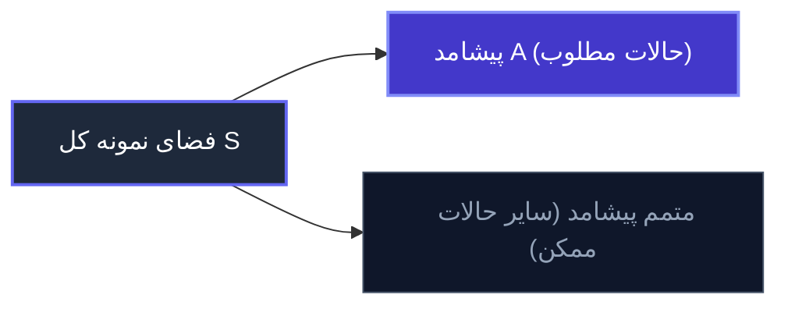

# جلسه اول: آشنایی با احتمال و اصول بنیادین شمارش

> **جمله کلیدی:**  
> «ریاضیات علم قطعیت است، در حالی که آمار و نظریه احتمال منطق و زبان رسمی برای فهم و مدل‌سازی **عدم قطعیت (Uncertainty)** در دنیای واقعی هستند.»

---

## ۱. چرا احتمال؟ (کاربردهای واقعی در علوم و مهندسی)

احتمال تنها یک مبحث مجرد ریاضی نیست؛ بلکه ابزاری است که در تمامی شاخه‌های دانش بشر به کار گرفته می‌شود:

* **فیزیک کوانتوم (Quantum Mechanics):** در مقیاس زیراتمی، قطعیت نیوتنی وجود ندارد؛ اصل عدم قطعیت هایزنبرگ و تابع موج شرودینگر تماماً بر پایه‌ چگالی احتمال توزیع ذرات بنا شده‌اند.
* **ژنتیک و زیست‌شناسی (Genetics):** مدل‌سازی انتقال ژن‌ها، قوانین وراثت مندل و جهش‌های ژنتیکی با قواعد احتمال بررسی می‌شوند.
* **تاریخ و زبان‌شناسی محاسباتی (Authorship Attribution):**  
  یک نمونه کلاسیک و درخشان، پژوهش **فردریک ماستلر (Frederick Mosteller)** و **دیوید والاس (David Wallace)** در سال ۱۹۶۳ بود. آن‌ها با تحلیل آماری بسامد واژگان (مانند کلمات ربط ساده)، نویسنده مقالات مناقشه‌برانگیز *The Federalist Papers* را میان الکساندر همیلتون و جیمز مدیسون با قطعیت آماری اثبات کردند.  
  *(جالب است بدانید فردریک ماستلر بنیان‌گذار دپارتمان آمار دانشگاه هاروارد در سال ۱۹۵۷ بود که در سال ۲۰۰۶ درگذشت).*
* **علوم سیاسی و اجتماعی:** مؤسسات پژوهشی پیشرفته نظیر **IQSS (مؤسسه علوم اجتماعی کمی هاروارد)** پیش‌بینی انتخابات، رفتار رأی‌دهندگان و الگوهای اجتماعی را بر پایه استنباط آماری انجام می‌دهند.
* **علوم اقتصادی و مالی:** قیمت‌گذاری دارایی‌ها، مدیریت ریسک، سبد سهام، رفتار بازار و تئوری بازی‌ها (Game Theory).
* **قمار و ریشه‌های تاریخی (۱۶۵۰ میلادی):** مکاتبات تاریخی میان **پی‌یر دو فرما (Pierre de Fermat)** و **بلز پاسکال (Blaise Pascal)** بر سر «مسئله امتیازها (Problem of Points)» در بازی تاس، سنگ بنای نظریه مدرن احتمال را پی‌ریزی کرد.

---

## ۲. تعریف شهودی یا کلاسیک احتمال (Naive Definition)

نقطه عطف تبدیل علم احتمال از فال‌بینی و طالع‌بینی به یک شاخه منسجم از ریاضیات، پیوند آن با **نظریه مجموعه‌ها (Set Theory)** بود.

### مفاهیم پایه:
1. **فضای نمونه (Sample Space - $S$):** مجموعه تمامی برآمدهای ممکن و متصور از یک آزمایش تصادفی.
2. **پیشامد (Event - $A$):** هر زیرمجموعه‌ای دلخواه از فضای نمونه ($A \subseteq S$). زمانی می‌گوییم پیشامد $A$ رخ داده که نتیجه آزمایش عضوی از مجموعه $A$ باشد.

### فرمول تعریف اولیه (Naive Definition):
اگر پیشامد $A$ در فضای نمونه $S$ رخ دهد، طبق تعریف شهودی:

$$P(A) = \frac{\text{تعداد برآمدهای مطلوب}}{\text{تعداد کل برآمدهای ممکن}} = \frac{|A|}{|S|}$$

> [!WARNING] دو فرض پنهان و بسیار محدودکننده در تعریف اولیه!
> فرمول بالا زمانی معتبر است که:
> ۱. فضای نمونه $S$ **متناهی (Finite)** باشد.  
> ۲. تمامی برآمدها دارای شانس کاملاً برابر و **هم‌شانس (Equally Likely)** باشند.

### چرا تعریف اولیه ناقص است؟ (دو مثال شهودی)

1. **پرتاب متوالی دو سکه (تقارن در انتخاب):**  
   اگر دو سکه پرتاب کنیم و بپرسیم «احتمال مشاهده دقیقاً یک خط چیست؟»، شخصی ممکن است بگوید ۳ حالت کلی داریم: (هر دو شیر، هر دو خط، یکی شیر و یکی خط) پس احتمال $\frac{1}{3}$ است!  
   این مغالطه از آنجا ناشی می‌شود که حالات هم‌شانس نیستند. فضای نمونه واقعی ۴ عضو دارد: $\{HH, HT, TH, TT\}$ و حالت یکی شیر و یکی خط دارای ۲ عضو است؛ بنابراین احتمال دقیق $\frac{2}{4} = \frac{1}{2}$ است.

2. **مثال مقایسه حیات و حیات هوشمند در سیاره نپتون:**  
   آیا روی سیاره نپتون حیات وجود دارد؟ اگر پاسخ دهیم «یا حیات دارد یا ندارد، پس احتمال آن ۵۰٪ (۱ از ۲) است»، دچار مغالطه فرض هم‌شانسی شده‌ایم! برآمدهای دوگانه لزوماً احتمال یکسان ندارند. همچنین اگر بپرسیم «حیات هوشمند چطور؟»، احتمال حیات هوشمند قاعدتاً باید اکیداً کوچک‌تر یا مساوی احتمال هر نوع حیات باشد، اما تعریف خام اولیه نمی‌تواند این وزن‌ها را منعکس کند.

3. **پارادوکس روز تولد (Birthday Problem):**  
   در گروهی متشکل از تنها ۲۳ نفر، احتمال اینکه حداقل دو نفر روز تولد یکسانی داشته باشند بیش از **۵۰٪** است! این شهود اولیه انسان‌ها را که انتظار دارند به جمع بسیار بزرگ‌تری نیاز باشد، به چالش می‌کشد؛ زیرا تعداد جفت‌های قابل مقایسه برابر است با:
   $$\binom{23}{2} = \frac{23 \times 22}{2} = 253 \text{ جفت}$$

---

## ۳. اصول شمارش (Counting Principles)

پایه و اساس محاسبه احتمالات در فضاهای گسسته و هم‌شانس، توانایی شمارش دقیق اندازه مجموعه‌ها بدون نیاز به فهرست کردن تک‌تک اعضاست.

### ۱. اصل ضرب (Multiplication Rule)
اگر آزمایشی شامل دو مرحله متوالی باشد به‌طوری که مرحله اول به $n_1$ روش ممکن و به ازای هر انتخاب در مرحله اول، مرحله دوم به $n_2$ روش ممکن انجام پذیرد، کل آزمایش به $n_1 \times n_2$ روش متمایز انجام می‌شود. (قابل تعمیم به $k$ مرحله: $n_1 \times n_2 \times \dots \times n_k$).

> [!TIP] نکته بسیار ظریف در افراز و دسته‌بندی مجموعه‌ها (تقسیم بر !k چه زمانی لازم است؟)
> فرض کنید می‌خواهیم ۱۰ نفر را به دو گروه تقسیم کنیم:
> 
> * **حالت الف: یک گروه ۴ نفره و یک گروه ۶ نفره:**  
>   تعداد حالات به سادگی برابر است با $\binom{10}{4} \times \binom{6}{6} = \binom{10}{4}$.  
>   چرا در اینجا تقسیم بر $2!$ نمی‌کنیم؟ زیرا نامتقارن بودن تعداد افراد (۴ و ۶) **خودبه‌خود ایجاد تمایز ساختاری** می‌کند. گروه ۴ نفره با گروه ۶ نفره به دلیل تفاوت اندازه، کاملاً متمایز و برچسب‌دار هستند.
>
> * **حالت ب: دو گروه ۵ نفره (بدون نام و بدون برچسب):**  
>   اگر بنویسیم $\binom{10}{5} \times \binom{5}{5}$، هر جفت گروه دوبار شمرده می‌شوند (مثلاً قرار گرفتن افراد $\{A,B,C,D,E\}$ در گروه اول و مابقی در گروه دوم، دقیقاً معادل قرار گرفتن مابقی در گروه اول و این پنج نفر در گروه دوم است، وقتی اسم گروه ۱ و ۲ در کار نباشد).  
>   بنابراین چون دو گروه دارای اندازه یکسان هستند و تمایز ذاتی ندارند، باید حاصل را بر $2!$ تقسیم کنیم:
>   $$\frac{\binom{10}{5}}{2!} = \frac{252}{2} = 126$$
>   *(اگر گروه‌ها دارای برچسب مشخص مثل تیم قرمز و تیم آبی بودند، تقسیم بر !۲ لازم نبود).*

---

## ۴. جدول چهارگانه نمونه‌گیری (The Four Sampling Cases)

فرض کنید مجموعه‌ای شامل $n$ شیء متمایز داریم و می‌خواهیم $k$ شیء از میان آن‌ها انتخاب کنیم. بسته به دو پارامتر **ترتیب (Order)** و **امکان تکرار/جایگذاری (Replacement)**، دقیقاً با چهار وضعیت روبه‌رو می‌شویم:

| وضعیت جایگذاری / ترتیب | ترتیب مهم است   (Order Matters) | ترتیب مهم نیست   (Order Does NOT Matter) |
| :--- | :---: | :---: |
| **بدون جایگذاری**   (Without Replacement) | **جایگشت (Permutation)**   $P(n, k) = \frac{n!}{(n-k)!}$ | **ترکیب (Combination)**   $\binom{n}{k} = \frac{n!}{k!(n-k)!}$ |
| **با جایگذاری**   (With Replacement) | **توان ساده**   $n^k$ | **چوب و ستاره (Stars & Bars)**   $\binom{n + k - 1}{k} = \binom{n + k - 1}{n - 1}$ |

---

### تحلیل دقیق، شهود فیزیکی و مثال‌های هر خانه:

#### ۱. ترتیب مهم + بدون جایگذاری ($P(n, k)$)
* **شهود ریاضی:** هر شیء حداکثر یک بار انتخاب می‌شود و توالی برگزیدن آن‌ها تمایز ایجاد می‌کند (مانند چیدن افراد در یک ردیف).
* **محاسبه از اصل ضرب:**
  $$n \times (n-1) \times (n-2) \times \dots \times (n-k+1) = \frac{n!}{(n-k)!}$$
* **مثال‌های ملموس:**
  - تعیین نفرات اول، دوم و سوم در مسابقه‌ای با $n$ دونده.
  - ساختن رمز عبور چندرقمی با ارقام متمایز.

#### ۲. ترتیب نامهم + بدون جایگذاری ($\binom{n}{k}$)
* **شهود ریاضی:** یک زیرمجموعه بدون ساختار $k$ عضوی از یک مجموعه $n$ عضوی انتخاب می‌کنیم. چون در خانه اول ترتیب $k!$ حالت اضافه تولید می‌کرد، نتیجه جایگشت را بر $k!$ تقسیم می‌کنیم.
* **فرمول ضریب دوجمله‌ای:**
  $$\binom{n}{k} = \frac{P(n,k)}{k!} = \frac{n!}{k!(n-k)!}$$
* **مثال‌های ملموس:**
  - دست کارت در بازی پاسور (انتخاب ۵ کارت از بین ۵۲ کارت بدون اهمیت ترتیب ورق‌ها).
  - انتخاب یک کمیته پژوهشی $k$ نفره از یک دانشکده $n$ نفره.

#### ۳. ترتیب مهم + با جایگذاری ($n^k$)
* **شهود ریاضی:** دنباله‌ای از انتخاب‌های کاملاً مستقل و دارای موقعیت زمانی/مکانی؛ در هر مرحله کل گزینه‌های اولیه مجدداً در دسترس هستند.
* **محاسبه از اصل ضرب:**
  $$\underbrace{n \times n \times \dots \times n}_{k \text{ بار}} = n^k$$
* **مثال‌های ملموس:**
  - رمز ۴ رقمی کارت بانکی با ارقام ۰ تا ۹ ($10^4 = 10,000$ حالت).
  - پرتاب متوالی یک تاس ۶ وجهی به تعداد $k$ بار ($6^k$).

#### ۴. ترتیب نامهم + با جایگذاری (Stars and Bars / Bose-Einstein)
* **شهود ریاضی:** اشیاء انتخاب‌شده قابل تشخیص از نظر تقدم و تأخر نیستند، اما می‌توانند تکرار شوند (شبیه پر کردن سبد خرید با اقلام دلخواه).
* **مدل‌سازی جبری معادل:**  
  تعداد جواب‌های صحیح و نامنفی معادله زیر با شرط $x_i \ge 0$:
  $$x_1 + x_2 + \dots + x_n = k$$
  *(که در آن $x_i$ نشان‌دهنده تعداد دفعات انتخاب شدن نوع $i$-ام است).*

* **تکنیک شهودی چوب و ستاره ($\star$ و $\mid$):**  
  تصور کنید $k$ ستاره ($\star$) به عنوان اقلام انتخابی و $n - 1$ دیواره جداکننده ($\mid$) برای تفکیک بین $n$ دسته یا جعبه مختلف داریم.  
  مجموع جایگاه‌های مورد نیاز برابر با $k + (n - 1)$ است. مسئله به سادگی به این تبدیل می‌شود که از بین این $n + k - 1$ موقعیت، مکان‌های قرارگیری $k$ ستاره (یا $n - 1$ دیواره) را انتخاب کنیم:
  $$\binom{n + k - 1}{k} = \binom{n + k - 1}{n - 1}$$

* **مثال‌های ملموس:**
  - خرید $k$ اسکوپ بستنی از یک بستنی‌فروشی با $n$ طعم گوناگون.
  - توزیع $k$ سکه یکسان میان $n$ کودک.
  - فیزیک آماری بوز-اینشتین (Bose-Einstein Statistics): توزیع ذرات بنیادی غیرقابل تمایز (مانند فوتون‌ها) در ترازهای انرژی متمایز.

---

## ۵. خلاصه و جمع‌بندی جلسه

1. نظریه احتمال، چارچوب ریاضی مطالعه عدم قطعیت است.
2. تعریف اولیه احتمال ($\frac{|A|}{|S|}$) دو محدودیت اساسی دارد: متناهی بودن و هم‌شانس بودن برآمدها.
3. تفکیک گروه‌های هم‌اندازه به دلیل عدم وجود تمایز طبیعی نیازمند تقسیم بر فاکتوریل تعداد گروه‌هاست.
4. جدول چهارگانه نمونه‌گیری ستون فقرات شمارش ترکیبیاتی در تمام مسائل احتمال گسسته است.

---

#احتمال #آمار #اصول_شمارش #فضای_نمونه #ترکیبیات #دانشگاه #استت۱۱۰
