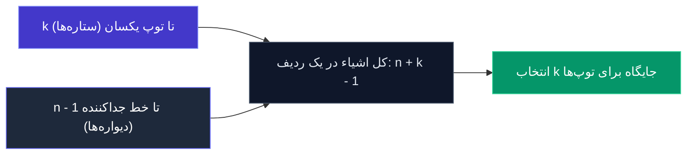

# جلسه دوم: اثبات داستانی و فرمول خط و توپ

> **مسئله محوری:**  
> در ریاضیات ترکیبیاتی، دو ابزار بسیار قدرتمند وجود دارند که محاسبات سنگین جبری را به شهودی عمیق و تفسیری تبدیل می‌کنند:
> 1. **اثبات داستانی (Story Proof):** اثبات تساوی‌ها از طریق روایت یک سناریوی شمارش به دو شیوه مستقل.
> 2. **تکنیک خط و توپ (Stars and Bars):** شاه‌کلید حل مسائل انتخاب با جایگذاری بدون ترتیب و شمارش جواب‌های صحیح معادلات جمعی.

---

## اثبات داستانی: جادوی شمارش با تفسیر (Story Proof)

پروفسور جو بلیتزستین (Joe Blitzstein) در دانشگاه هاروارد تاکید ویژه‌ای روی این مفهوم دارد:

> **ایده اصلی اثبات داستانی چیست؟**  
> به جای اینکه خودمان را در باتلاق محاسبات جبری، فاکتوریل‌ها و ساده‌سازی‌های خسته‌کننده غرق کنیم، برای دو طرف یک تساوی یک **«داستان یا سناریوی شمارش مشترک»** تعریف می‌کنیم. اگر نشان دهیم سمت چپ و سمت راست تساوی در واقع **یک پدیده واحد را به دو شیوه مختلف و معتبر می‌شمارند**، تساوی بدون نیاز به حتی یک خط جبر اثبات می‌شود!

---

### مثال اول: تقارن در انتخاب و کنار گذاشتن

$$\binom{n}{k} = \binom{n}{n - k}$$

* **داستان مسئله:** فرض کنید یک گروه $n$ نفره داریم و می‌خواهیم یک تیم $k$ نفره برای یک پروژه انتخاب کنیم.
* **روایت اول (سمت چپ):** مستقیماً به سراغ افراد می‌رویم و $k$ نفر را از بین $n$ نفر برمی‌گزینیم؛ تعداد حالات: $\binom{n}{k}$.
* **روایت دوم (سمت راست):** به جای مشخص کردن اعضای تیم، تصمیم می‌گیریم افرادی را انتخاب کنیم که در پروژه **حضور ندارند**! یعنی $n - k$ نفر را برای کنار گذاشته شدن انتخاب می‌کنیم و مابقی خودبه‌خود عضو تیم می‌شوند؛ تعداد حالات: $\binom{n}{n - k}$.
* **نتیجه:** هر انتخاب $k$ نفره دقیقاً متناظر با یک انتخاب $n - k$ نفره برای کنار رفتن است. پس هر دو طرف تساوی یک کمیت واحد را می‌شمارند.

---

### مثال دوم: انتخاب تیم به همراه سرگروه

$$n \binom{n - 1}{k - 1} = k \binom{n}{k}$$

* **داستان مسئله:** از میان یک جامعه $n$ نفره، می‌خواهیم یک کمیته‌ی $k$ نفره تشکیل دهیم که **دقیقاً یک نفر از اعضای آن به عنوان رئیس یا سرگروه** تعیین شده باشد.

* **روایت اول (ابتدا تعیین سرگروه):**
  1. اول از کل $n$ داوطلب، ۱ نفر را به عنوان سرگروه منصوب می‌کنیم: $n$ حالت.
  2. سپس از بین $n - 1$ داوطلب باقی‌مانده، $k - 1$ عضو عادی دیگر تیم را برمی‌گزینیم: $\binom{n - 1}{k - 1}$ حالت.
  3. طبق اصل ضرب:
     $$n \binom{n - 1}{k - 1}$$

* **روایت دوم (ابتدا انتخاب کل اعضای تیم):**
  1. ابتدا کل کمیته‌ی $k$ نفره را از بین $n$ نفر انتخاب می‌کنیم: $\binom{n}{k}$ حالت.
  2. حالا از میان همین $k$ نفر انتخاب‌شده، ۱ نفر را به عنوان سرگروه مشخص می‌کنیم: $k$ حالت.
  3. طبق اصل ضرب:
     $$k \binom{n}{k}$$

* **نتیجه:** چون هر دو روایت دقیقاً تعداد حالت‌های ساخت «یک کمیته $k$ نفره با یک سرگروه مشخص» را می‌شمارند، برابری دو طرف بدیهی است:
$$n \binom{n - 1}{k - 1} = k \binom{n}{k} \quad \blacksquare$$

---

### مثال سوم: اتحاد وندرموند (Vandermonde's Identity)

$$\binom{m + n}{k} = \sum_{j = 0}^{k} \binom{m}{j} \binom{n}{k - j}$$

* **داستان مسئله:** فرض کنید در یک دانشکده، $m$ دانشجوی مهندسی و $n$ دانشجوی علوم پایه داریم (در مجموع $m + n$ نفر). می‌خواهیم یک شورای دانشجویی $k$ نفره انتخاب کنیم.

* **روایت اول (بدون تفکیک گروهی):**
  بدون در نظر گرفتن رشته، مستقیماً از کل جمعیت $m + n$ نفره، یک تیم $k$ نفره انتخاب می‌کنیم:
  $$\binom{m + n}{k}$$

* **روایت دوم (افراز بر اساس تعداد دانشجویان مهندسی):**
  تعداد دانشجویان مهندسی درون این تیم $k$ نفره می‌تواند از $0$ نفر تا حداکثر $k$ نفر متغیر باشد.  
  اگر فرض کنیم دقیقاً $j$ نفر از اعضای شورا مهندس باشند ($0 \le j \le k$)، پس الزاماً مابقی اعضا یعنی $k - j$ نفر باید از دانشجویان علوم پایه باشند:
  1. انتخاب $j$ دانشجوی مهندسی از بین $m$ نفر: $\binom{m}{j}$
  2. انتخاب $k - j$ دانشجوی علوم پایه از بین $n$ نفر: $\binom{n}{k - j}$
  3. طبق اصل ضرب، تعداد حالات به ازای یک $j$ مشخص: $\binom{m}{j} \binom{n}{k - j}$

  چون این حالات به ازای مقادیر مختلف $j$ با هم **ناسازگار و مجزا (Disjoint)** هستند (یک شورا نمی‌تواند هم‌زمان هم دارای ۲ مهندس باشد و هم ۳ مهندس)، طبق اصل جمع کل حالات برابر است با حاصل‌جمع روی تمام مقادیر مجاز $j$:
  $$\sum_{j = 0}^{k} \binom{m}{j} \binom{n}{k - j}$$

* **نتیجه:** هر دو روش یک مسئله واحد را شمرده‌اند؛ بنابراین اتحاد مشهور وندرموند بدون حتی یک خط عملیات فاکتوریلی اثبات می‌شود!

---

## صورت مسئله خط و توپ و ترجمه جبری آن

فرض کنید می‌خواهیم $k$ بار از میان $n$ گروه مختلف انتخاب انجام دهیم. ترتیب مهم نیست و هر گروه می‌تواند چندین بار (یا اصلاً) انتخاب شود.

### مدل‌سازی با معادله دیوفانتی
اگر فرض کنیم از گروه اول $x_1$ بار، از گروه دوم $x_2$ بار، ... و از گروه $n$-ام $x_n$ بار انتخاب کنیم، مسئله دقیقاً معادل پیدا کردن **تعداد پاسخ‌های صحیح و نامنفی** معادله زیر است:

$$x_1 + x_2 + x_3 + \dots + x_n = k \quad , \quad x_i \in \{0, 1, 2, \dots\}$$

* $k$: تعداد کل انتخاب‌ها (توپ‌ها یا اشیاء).
* $n$: تعداد دسته‌ها، سبدها یا متغیرها.
* $x_i \ge 0$: یعنی یک سطل می‌تواند کاملاً خالی بماند ($x_i = 0$).

---

## ایده نبوغ‌آمیز خط و توپ (Stars & Bars)

چرا شمارش مستقیم این حالت دشوار است؟ چون متغیرها مستقل نیستند و با هم جمع می‌شوند.  
تکنیک **ویلیام فلر (William Feller)**، ریاضیدان برجسته نظریه احتمال، تبدیل یک مسئله جبری به یک مسئله **آرایش خطی اشیاء یکسان** است:

### گام‌های اثبات دقیق:

1. **نمایش اشیاء انتخابی با توپ‌ها ($\bullet$):**  
   ما $k$ شیء غیرقابل تمایز داریم که با $k$ دایره یا ستاره نمایش می‌دهیم:
   $$\underbrace{\bullet \quad \bullet \quad \bullet \quad \dots \quad \bullet}_{k \text{ تا توپ}}$$

2. **ایجاد مرز بین دسته‌ها با خط‌ها ($\mid$):**  
   برای اینکه این $k$ توپ را بین $n$ دسته تقسیم کنیم، به چند دیواره جداکننده نیاز داریم؟  
   برای ساختن ۲ دسته به ۱ خط نیاز است ($A \mid B$). برای ۳ دسته به ۲ خط ($A \mid B \mid C$).  
   پس برای $n$ دسته، دقیقاً به **$n - 1$ خط جداکننده** نیاز داریم.

3. **یک به یک بودن نگاشت (Bijection):**  
   هر چینش از $k$ توپ و $n-1$ خط، متناظر با یک و تنها یک جواب برای معادله است و بالعکس!
   
   > **مثال عینی:** فرض کنید ۳ نفر ($n=3$) می‌خواهند ۵ مداد یکسان ($k=5$) را تقسیم کنند ($x_1 + x_2 + x_3 = 5$):
   > 
   > * تعداد توپ‌ها: ۵ تا ($\bullet \bullet \bullet \bullet \bullet$)
   > * تعداد خطوط: $3 - 1 = 2$ خط ($\mid \quad \mid$)
   > 
   > یک چینش فرضی:
   > $$\bullet \bullet \mid \bullet \bullet \bullet \mid$$
   > * سمت چپ خط اول: ۲ توپ $\implies x_1 = 2$
   > * بین خط اول و دوم: ۳ توپ $\implies x_2 = 3$
   > * سمت راست خط دوم: ۰ توپ $\implies x_3 = 0$  
   > *(مجموع: $2 + 3 + 0 = 5$)*

4. **شمارش کل جایگاه‌ها:**  
   در کل، یک نوار شامل $k + (n - 1)$ جایگاه داریم که می‌خواهیم در آن‌ها:
   * یا جایگاه $k$ تا توپ را انتخاب کنیم:
     $$\binom{k + n - 1}{k}$$
   * یا جایگاه $n - 1$ تا خط جداکننده را انتخاب کنیم:
     $$\binom{k + n - 1}{n - 1}$$

چون طبق ویژگی تقارن ترکیب‌ها داریم $\binom{m}{r} = \binom{m}{m-r}$، این دو عبارت کاملاً برابرند:

$$\text{حالات کل} = \binom{n + k - 1}{k} = \binom{n + k - 1}{n - 1} \quad \blacksquare$$

---

## حالت متغیرهای اکیداً مثبت

گاهی در صورت مسئله قید می‌شود که **«به هر سبد حداقل یک شیء برسد»** (یا به هر فرد حداقل یک سهم تعلق گیرد):

$$x_1 + x_2 + \dots + x_n = k \quad , \quad x_i \ge 1 \quad (k \ge n)$$

برای حل این حالت دو رویکرد زیبا وجود دارد:

### روش اول: تغییر متغیر جبری
به ازای هر $i$ تعریف می‌کنیم $y_i = x_i - 1$. چون $x_i \ge 1$، پس $y_i \ge 0$ خواهد بود.  
حال با جایگذاری در معادله اصلی:

$$(y_1 + 1) + (y_2 + 1) + \dots + (y_n + 1) = k \implies y_1 + y_2 + \dots + y_n = k - n$$

حالا یک مسئله خط و توپ استاندارد با متغیرهای نامنفی ($y_i \ge 0$) داریم که مجموع آن‌ها برابر با $k - n$ است. طبق فرمول اثبات‌شده:

$$\binom{n + (k - n) - 1}{(k - n)} = \binom{k - 1}{k - n} = \binom{k - 1}{n - 1}$$

### روش دوم: شهود فیزیکی فاصله‌ها
$k$ توپ را با فاصله کنار هم می‌چینیم. بین این $k$ توپ، دقیقاً **$k - 1$ شکاف خالی** وجود دارد:

$$\bullet \ \underset{1}{\wedge} \ \bullet \ \underset{2}{\wedge} \ \bullet \dots \bullet \ \underset{k-1}{\wedge} \ \bullet$$

چون هیچ دسته‌ای نباید صفر باشد، نمی‌توانیم دو خط را در یک جا یا در ابتدا و انتها قرار دهیم؛ بلکه باید از بین این $k - 1$ شکاف موجود، مکان قرارگیری $n - 1$ خط را انتخاب کنیم:

$$\binom{k - 1}{n - 1}$$

---

## مقایسه جامع دو حالت خط و توپ

| نوع شرط روی متغیرها | معنای شهودی در مسئله | فرمول تعداد جواب‌ها |
| :--- | :--- | :---: |
| **نامنفی ($x_i \ge 0$)** | دسته‌ها می‌توانند خالی بمانند (سبد خرید آزاد) | $\binom{n + k - 1}{k} = \binom{n + k - 1}{n - 1}$ |
| **اکیداً مثبت ($x_i \ge 1$)** | به هر دسته حداقل یک شیء می‌رسد (هیچکس بی‌نصیب نیست) | $\binom{k - 1}{n - 1}$ |

---

## مثال‌های حل‌شده و تیپ‌های کاربردی

### مثال ۱: بستنی‌فروشی با طعم‌های مختلف
می‌خواهیم یک ظرف بستنی با ۸ اسکوپ ($k = 8$) از یک بستنی‌فروشی که ۵ طعم مختلف ($n = 5$) ارائه می‌دهد سفارش دهیم. ترتیب اسکوپ‌ها مهم نیست. به چند روش این کار ممکن است؟

> **حل:**  
> چون می‌توان از یک طعم چند اسکوپ یا حتی هیچ اسکوپی نگرفت ($x_i \ge 0$):  
> $$x_1 + x_2 + x_3 + x_4 + x_5 = 8$$  
> $$\text{تعداد حالات} = \binom{5 + 8 - 1}{8} = \binom{12}{8} = \binom{12}{4} = \frac{12 \times 11 \times 10 \times 9}{4 \times 3 \times 2 \times 1} = 495$$

---

### مثال ۲: توزیع نامتقارن با پیش‌شرط‌های حداقل
فرض کنید ۱۲ سکه یکسان را می‌خواهیم بین ۳ کودک طوری تقسیم کنیم که کودک اول حداقل ۲ سکه، کودک دوم حداقل ۱ سکه و سومی حداقل ۳ سکه بگیرد.

> **حل:**  
> معادله اولیه: $x_1 + x_2 + x_3 = 12$ با شرایط $x_1 \ge 2 , x_2 \ge 1 , x_3 \ge 3$.  
> 
> **ایده:** سهمیه‌های تضمین‌شده را ابتدا پرداخت می‌کنیم!  
> مجموع سکه‌های تضمینی: $2 + 1 + 3 = 6$ سکه.  
> تعداد سکه‌های باقی‌مانده آزاد: $12 - 6 = 6$ سکه.  
> 
> حال این ۶ سکه باقی‌مانده را بدون هیچ محدودیتی ($y_i \ge 0$) بین ۳ نفر تقسیم می‌کنیم:  
> $$y_1 + y_2 + y_3 = 6$$  
> $$\text{تعداد حالات} = \binom{3 + 6 - 1}{6} = \binom{8}{6} = \binom{8}{2} = \frac{8 \times 7}{2} = 28$$

---

## ارتباط با فیزیک آماری بوز-اینشتین

در فیزیک کوانتوم، ذرات بنیادی به دو دسته کلی تقسیم می‌شوند:
1. **فرمیون‌ها (الکترون‌ها، پروتون‌ها و...):** از اصل طرد پاولی پیروی می‌کنند؛ در هر تراز انرژی حداکثر یک ذره قرار می‌گیرد (متناظر با خانه **بدون جایگذاری** $\binom{n}{k}$).
2. **بوزون‌ها (فوتون‌ها، گلوئون‌ها و...):** هیچ محدودیتی در تجمع ندارند و می‌توانند به تعداد دلخواه در یک تراز انرژی قرار گیرند (متناظر با همین خانه چهارم و فرمول خط و توپ $\binom{n + k - 1}{k}$).

---

#احتمال #اصول_شمارش #اثبات_داستانی #اتحاد_وندرموند #خط_و_توپ #ستاره_و_میله #چوب_و_ستاره #ترکیبیات #استت۱۱۰ #ریاضیات #دانشگاه
