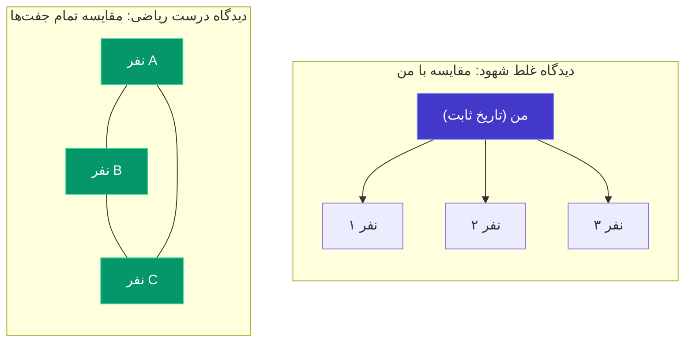
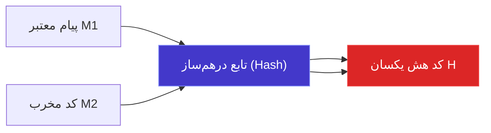

# جلسه سوم: مسئله و پارادوکس روز تولد

> **مسئله کلاسیک:**  
> در یک اتاق چند نفر باید حضور داشته باشند تا با احتمال حداقل **۵۰ درصد**، حداقل دو نفر دارای روز تولد یکسانی در سال باشند؟  
> شهود اولیه انسان معمولاً اعدادی مثل ۱۸۰ (نصف روزهای سال) را پیشنهاد می‌دهد؛ اما پاسخ واقعی ریاضی تنها **۲۳ نفر** است!

---

## چرا مسئله روز تولد را یک «پارادوکس» می‌نامند؟

در ریاضیات، واژه **پارادوکس (Paradox)** همیشه به معنای تناقض منطقی نیست؛ بلکه در بیشتر موارد به پدیده‌هایی گفته می‌شود که در عین **صحت قطعی ریاضی**، به‌شدت با **شهود اولیه و ساختار ذهنی انسان** در تضادند.

### منشأ خطای شهود ذهن انسان چیست؟
وقتی صورت مسئله را می‌شنویم، مغز ما به اشتباه سوال را این‌گونه بازتعریف می‌کند:
> *«چند نفر باید در اتاق باشند تا احتمال اینکه حداقل یک نفر با **من** هم‌تولد باشد بالای ۵۰٪ شود؟»*

برای اینکه فردی با تاریخ تولد مشخص شما هم‌تولد شود، واقعاً به جمعیتی حدود **۲۵۳ نفر** نیاز است!  
اما صورت مسئله هرگز روی «یک تاریخ تولد از پیش تعیین‌شده» یا «تولد شما» قفل نکرده است؛ بلکه مسئله به دنبال **«هرگونه تصادف مشترک میان هر دو عضو اتاق»** می‌گردد.

---

## قدرت تصاعدی جفت‌ها (The Power of Pairs)

فرض کنید $k$ نفر در اتاق حضور دارند. تعداد راه‌های انتخاب ۲ نفر از میان این $k$ نفر (تعداد تمام مقایسه‌های ممکن دو‌به‌دو) برابر است با:

$$\binom{k}{2} = \frac{k(k - 1)}{2}$$

بیایید این رابطه را برای چند مقدار مختلف از $k$ بررسی کنیم:

* اگر $k = 4$ باشد: $\binom{4}{2} = 6$ جفت مقایسه داریم.
* اگر $k = 10$ باشد: $\binom{10}{2} = 45$ جفت مقایسه داریم.
* اگر $k = 23$ باشد:
  $$\binom{23}{2} = \frac{23 \times 22}{2} = 253 \text{ جفت مقایسه!}$$

در اتاقی با تنها ۲۳ نفر، ما با ۲۳ تولد مستقل طرف نیستیم؛ بلکه **۲۵۳ فرصت مستقل برای جفت شدن تاریخ‌ها** در برابر ۳۶۵ روز سال داریم! با ۲۵۳ جفت مقایسه، کاملاً شهودی است که احتمال رخ دادن حداقل یک تطابق از ۵۰ درصد عبور کند.

---

## اثبات دقیق ریاضی با تکنیک متمم

### فرضیات ساده‌کننده استاندارد:
1. سال را بدون سال کبیسه و برابر با ۳۶۵ روز در نظر می‌گیریم ($N = 365$).
2. احتمال تولد در تمامی روزهای سال یکسان و برابر با $\frac{1}{365}$ است.
3. روزهای تولد افراد مستقل از یکدیگرند (دوقلوها یا چندقلوها حضور ندارند).

### چرا محاسبه مستقیم دشوار است؟
اگر بخواهیم مستقیماً احتمال «حداقل دو نفر هم‌تولد» را بشماریم، با انبوهی از حالات ناسازگار و پیچیده روبه‌رو می‌شویم:
* دقیقاً ۲ نفر در یک روز، و بقیه متفاوت
* دقیقاً ۳ نفر در یک روز
* دو جفت متفاوت که هر جفت در یک روز به دنیا آمده‌اند
* و ده‌ها حالت ترکیبی دیگر!

### استفاده از اصل متمم (Complement Rule):
راهکار نجات‌بخش، محاسبه پیشامد متمم یعنی **«هیچ دو نفری روز تولد یکسان نداشته باشند (تمام $k$ نفر در روزهای متمایز متولد شده باشند)»** است:

$$P(\text{حداقل یک تشابه}) = 1 - P(\text{همه تولدها متمایز})$$

#### مرحله اول: فضای نمونه کل ($|S|$)
هر یک از $k$ نفر می‌تواند در یکی از ۳۶۵ روز سال به دنیا آمده باشد. با اصل ضرب:

$$|S| = \underbrace{365 \times 365 \times \dots \times 365}_{k \text{ بار}} = 365^k$$

#### مرحله دوم: حالات مطلوب متمم ($|A^c|$)
برای اینکه هیچ دو نفری در یک روز نباشند:
* نفر اول می‌تواند در هر یک از ۳۶۵ روز متولد شده باشد (۳۶۵ حالت).
* نفر دوم نباید با اولی در یک روز باشد (۳۶۴ روز باقی‌مانده).
* نفر سوم نباید با دو نفر اول مشترک باشد (۳۶۳ روز باقی‌مانده).
* ...
* نفر $k$-ام نباید با هیچ‌یک از $k-1$ نفر قبلی مشترک باشد ($365 - (k - 1) = 365 - k + 1$ روز).

طبق اصل ضرب:

$$|A^c| = 365 \times 364 \times 363 \times \dots \times (365 - k + 1) = \frac{365!}{(365 - k)!} = P(365, k)$$

#### مرحله سوم: محاسبه احتمال
کسر احتمال پیشامد متمم:

$$P(A^c) = \frac{|A^c|}{|S|} = \frac{365 \times 364 \times 363 \times \dots \times (365 - k + 1)}{365^k}$$

می‌توانیم این کسر را به صورت حاصل‌ضرب $k$ کسر تفکیک کنیم:

$$P(A^c) = \left(\frac{365}{365}\right) \times \left(\frac{364}{365}\right) \times \left(\frac{363}{365}\right) \times \dots \times \left(\frac{365 - k + 1}{365}\right)$$

$$P(A^c) = \prod_{i = 0}^{k - 1} \left(1 - \frac{i}{365}\right)$$

در نتیجه، احتمال اصلی مسئله روز تولد برابر است با:

$$P(\text{Match}) = 1 - \prod_{i = 0}^{k - 1} \left(1 - \frac{i}{365}\right) \quad \blacksquare$$

---

## جدول مقادیر احتمال بر حسب تعداد افراد ($k$)

| تعداد افراد ($k$) | تعداد جفت‌های مقایسه $\binom{k}{2}$ | احتمال تشابه حداقل یک جفت | وضعیت شهودی |
| :---: | :---: | :---: | :--- |
| **۱۰** | ۴۵ | **۱۱.۷٪** | شانس اندک |
| **۲۰** | ۱۹۰ | **۴۱.۱٪** | نزدیک به مرز برابری |
| **۲۳** | **۲۵۳** | **۵۰.۷٪** | **نقطه عطف (بیش از ۵۰٪ شانس)** |
| **۳۰** | ۴۳۵ | **۷۰.۶٪** | احتمال غالب |
| **۴۰** | ۷۸۰ | **۸۹.۱٪** | تشابه تقریباً قطعی |
| **۵۰** | ۱٬۲۲۵ | **۹۷.۰٪** | وقوع تقریباً حتمی |
| **۷۰** | ۲٬۴۱۵ | **۹۹.۹٪** | قطعی در عمل |
| **۳۶۶** | ۶۶٬۷۹۵ | **۱۰۰٪** | **قطعیت ریاضی محض (اصل لانه کبوتری)** |

> **نکته در مورد $k \ge 366$:**  
> اگر تعداد افراد در اتاق ۳۶۶ نفر باشد، طبق **اصل لانه کبوتری دیریکله (Pigeonhole Principle)**، چون تنها ۳۶۵ روز در سال داریم، امکان ندارد تمام افراد روزهای مجزایی داشته باشند و احتمال تشابه دقیقاً $1$ (۱۰۰٪) می‌شود.

---

## تقریب تحلیلی با استفاده از بسط تیلور

محاسبه حاصل‌ضرب عددی $\prod_{i=0}^{k-1} (1 - \frac{i}{365})$ با دست برای مقادیر بزرگ بسیار زمان‌بر است. چطور می‌توانیم رابطه تحلیلی ساده‌ای برای پیدا کردن نقطه عطف ۵۰٪ به دست آوریم؟

از حساب دیفرانسیل و انتگرال و بسط تیلور می‌دانیم که برای مقادیر بسیار کوچک $x$ ($x \ll 1$):

$$e^{-x} \approx 1 - x$$

چون در مسئله ما مقادیر $\frac{i}{365}$ کوچک هستند، می‌توان تقریب زد:

$$1 - \frac{i}{365} \approx e^{-\frac{i}{365}}$$

حال با جایگذاری در رابطه پیشامد متمم:

$$P(A^c) \approx \prod_{i = 0}^{k - 1} e^{-\frac{i}{365}} = e^{-\sum_{i = 0}^{k - 1} \frac{i}{365}} = e^{-\frac{1}{365} \sum_{i = 0}^{k - 1} i}$$

از فرمول مجموع اعداد حسابی می‌دانیم $\sum_{i=0}^{k-1} i = \frac{(k-1)k}{2} = \binom{k}{2}$. بنابراین:

$$P(A^c) \approx e^{-\frac{k(k - 1)}{2 \times 365}} = e^{-\frac{\binom{k}{2}}{365}}$$

$$P(\text{Match}) \approx 1 - e^{-\frac{k(k - 1)}{730}}$$

### محاسبه نقطه عطف ۵۰٪:
برای اینکه احتمال تشابه حداقل ۵۰٪ ($0.5$) شود:

$$1 - e^{-\frac{k(k - 1)}{730}} \ge 0.5 \implies e^{-\frac{k(k - 1)}{730}} \le 0.5$$

با گرفتن لگاریتم طبیعی ($\ln$) از دو طرف:

$$-\frac{k(k - 1)}{730} \le \ln(0.5) = -\ln 2$$

$$\frac{k(k - 1)}{730} \ge \ln 2 \approx 0.693$$

$$k(k - 1) \ge 730 \times 0.693 \approx 505.9$$

اگر تقریب $k(k-1) \approx k^2$ را بزنیم:

$$k^2 \approx 506 \implies k \approx \sqrt{506} \approx 22.49 \implies k = 23$$

### فرمول کلی برای سالی با $N$ روز
به طور کلی در سیاره‌ای با سال $N$ روزه، حداقل افراد لازم برای داشتن شانس ۵۰٪ تشابه برابر است با:

$$k \approx \sqrt{2N \ln 2} \approx 1.177 \sqrt{N}$$

این نتیجه نشان می‌دهد که رشد تعداد افراد متناسب با **جذر تعداد روزها ($\sqrt{N}$)** است و نه خود $N$!

---

## آیا در دنیای واقعی این احتمال کمتر است یا بیشتر؟

در دنیای واقعی، توزیع تولدها در طول سال کاملاً یکنواخت نیست (مثلاً در فصل‌های خاص مانند اواخر تابستان نرخ موالید بالاتر است).  

> **نکته کلیدی به روایت جو بلیتزستین:**  
> آیا غیریکنواخت بودن احتمال تولد در روزهای مختلف سال، احتمال برخورد را کاهش می‌دهد یا افزایش؟  
> **پاسخ شگفت‌انگیز:** هرگونه عدم یکنواختی، شانس تشابه تولدها را **افزایش می‌دهد!**  
> طبق نامساوی کوشی-شوارتز یا تحدب، حالتی که در آن تمام روزها شانس برابر دارند ($\frac{1}{365}$)، نقطه‌ای است که در آن احتمال برخورد **حداقل ممکن (Minima)** است. هر چه توزیع نامتقارن‌تر باشد، احتمال هم‌پوشانی بیشتر می‌شود!

---

## کاربرد حیاتی در علوم کامپیوتر: حمله روز تولد (Birthday Attack)

این پارادوکس فراتر از یک سرگرمی ریاضی، یکی از **ستون‌های امنیت شبکه و مبانی رمزنگاری مدرن** است.

### برخورد در توابع هش (Hash Collision)
در علوم کامپیوتر، توابع درهم‌ساز (Hash Functions) نظیر MD5، SHA-1 و SHA-256 ورودی‌هایی با طول دلخواه را به یک رشته بیتی با طول ثابت $b$ بیت تبدیل می‌کنند. تعداد کل خروجی‌های ممکن برابر است با:

$$N = 2^b$$

یک تابع هش امن باید در برابر **«برخورد (Collision)»** مقاوم باشد؛ یعنی پیدا کردن دو ورودی متمایز $x \ne y$ که هش یکسانی تولید کنند ($H(x) = H(y)$) باید غیرممکن باشد.

### چرا حمله روز تولد امنیت را نصف می‌کند؟
اگر حمله‌کننده بخواهد هشی مطابق با یک فایل خاص پیدا کند، به حدود $2^b$ تلاش نیاز دارد (مشابه مقایسه با تاریخ تولد شما).  
اما اگر حمله‌کننده فقط بخواهد **هر دو ورودی دلخواهی** را بیابد که هش تصادفی یکسانی تولید کنند، طبق فرمول تقریب روز تولد به چند تلاش نیاز دارد؟

$$k \approx 1.177 \sqrt{N} = 1.177 \sqrt{2^b} = 1.177 \times 2^{b/2} \approx \mathcal{O}(2^{b/2})$$

* **پیامد امنیتی فاجعه‌بار:**  
  یک الگوریتم هش با خروجی ۱۲۸ بیتی (مانند MD5)، مقاومتی معادل $2^{128}$ ندارد؛ بلکه یک هکر با تنها حدود $2^{64}$ بار اجرای الگوریتم می‌تواند با شانس بیش از ۵۰٪ یک برخورد پیدا کند و امضای دیجیتال را جعل نماید!  
  به همین دلیل، استانداردهای رمزنگاری امروزی مانند **SHA-256** از هش‌های ۲۵۶ بیتی استفاده می‌کنند تا امنیت آن‌ها در برابر حمله روز تولد در سطح مطمئن $2^{128}$ باقی بماند.

---

#احتمال #روز_تولد #پارادوکس_روز_تولد #استت۱۱۰ #رمزنگاری #توابع_هش #حمله_روز_تولد #ترکیبیات #دانشگاه
